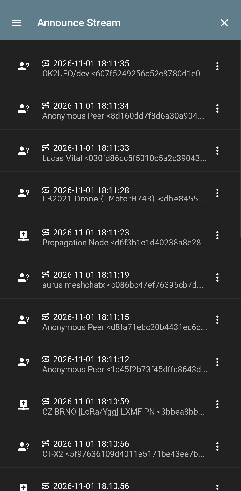
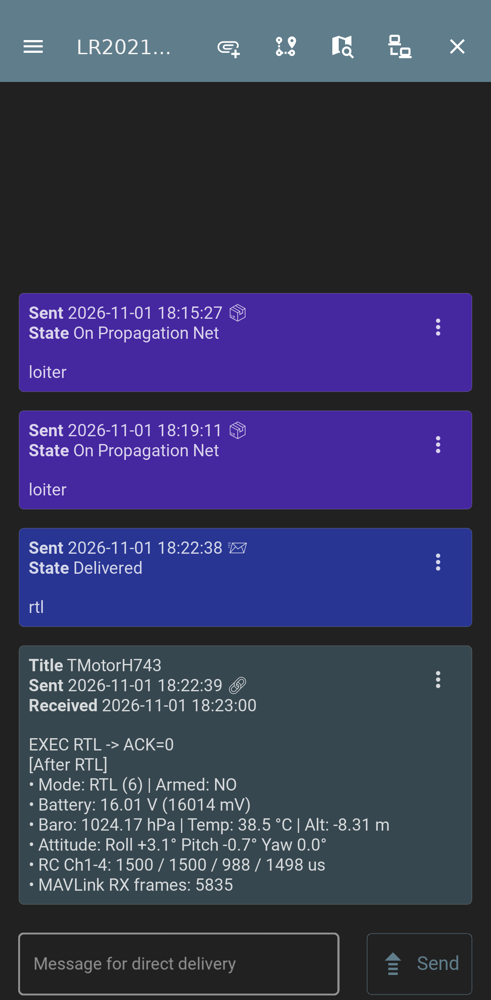
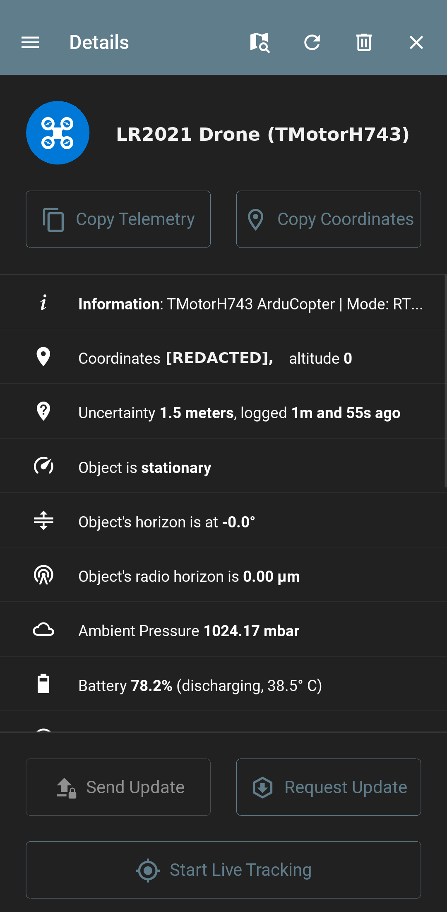

# lr2021-elrs

Bare-metal ExpressLRS v3/v4 transceiver (`ELRS_TX`, `ELRS_RX`), passive over-the-air packet monitor (`MONITOR`), raw FLRC packet bridge (`BRIDGE`), Reticulum `RNode` KISS TNC (`RNODE`), and airborne Reticulum mesh repeater + MAVLink flight-controller bridge (`RELAY`) firmware for the Seeed Studio Semtech LR2021 LoRa Plus Evaluation Kit (`Seeed Studio XIAO nRF54L15` + `Wio-LR2021`).

## Features

- **Dual-Band RF Support (Sub-GHz & 2.4 GHz):** Operates on Sub-GHz (`EU868` 863.275–869.575 MHz, `FCC915` 903.5–926.9 MHz, `AU915` 915.5–926.9 MHz) and 2.4 GHz (`CE_LBT` and `ISM2G4` 2400.4–2479.4 MHz) using the Semtech LR2021 (`0x0118`) transceiver.
- **Reticulum (`rnsd`) & RNode Integration (`firmware/rnode/`):**
  - **Plug-and-Play `RNodeInterface` (`RNODE` mode):** Implements the RNode KISS protocol (`FEND=0xC0`, `FESC=0xDB`, `CMD_DETECT=0x08 -> 0x46`, `CMD_FW_VERSION=1.63`, `CMD_PLATFORM=0xF0`, `CMD_MCU=0x81`, `CMD_FREQUENCY`, `CMD_BANDWIDTH`, `CMD_TXPOWER`, `CMD_SF`, `CMD_CR`, `CMD_RADIO_STATE`, `CMD_STAT_PHYPRM`, `CMD_STAT_RSSI`, `CMD_STAT_SNR`, `CMD_DATA`, `CMD_READY=0x0F`, `CMD_LEAVE=0x0A`). Automatically enters `RNODE` mode when a KISS `FEND` (`0xC0`) frame arrives on USB CDC.
  - **Airborne Reticulum Store-and-Forward Repeater (`RELAY` mode):** Receives variable-length explicit-header LoRa packets up to 255 bytes on 863–868 MHz (or 2.4 GHz), deduplicates via a 64-entry FNV-1a invariant packet-hash ring with a 10 s window, increments `hops` (`pkt[1]`) on unmasked packets, and preserves exact bytes on IFAC-authenticated packets (`pkt[0] & 0x80`).
  - **Flight Controller MAVLink v2 Bridge (`TMotorH743` / ArduPilot):** Parses incoming MAVLink v1/v2 `HEARTBEAT`, `SYS_STATUS`, and `GLOBAL_POSITION_INT` telemetry on the Grove UART (`D6`/`D7`) into Reticulum `rnlog.beacon` JSON broadcasts, and translates incoming Reticulum `elrs.drone.cmd` packets (`GOTO <lat_e7> <lon_e7> <alt_m>`, `RTL`, `LOITER`, `LAND`, `ARM`, `DISARM`, `MODE <n>`, `RC <c1..c4>`) into MAVLink v2 `MISSION_ITEM_INT` (`#73`) and `COMMAND_LONG` (`#76`) frames sent to the flight controller.
  - **Reticulum-over-ExpressLRS FHSS Tunnel (`ELRS_PKT_TYPE_DATA`):** Fragments and reassembles Reticulum packets up to 500 bytes across `OTA4` (8-byte, 5 B/fragment) and `OTA8` (13-byte, 10 B/fragment) ExpressLRS `DATA` (`0x01`) frames with configurable fragment redundancy (`repeats=2`), multiplexing mesh traffic alongside live 200 Hz / 1000 Hz RC control and `LINKSTATS` telemetry.
- **23 ExpressLRS Air Rates:**
  - **2.4 GHz GFSK + Hamming(7,4) FEC:** `2G4_K1000` (1000 Hz, 300 kbps, 8B->14B FEC), `2G4_DK500`, `2G4_DK250`
  - **2.4 GHz FLRC:** `2G4_F1000` (1000 Hz, 650 kbps), `2G4_F500`, `2G4_D500`, `2G4_D250`
  - **2.4 GHz LoRa (800 kHz BW):** `2G4_500HZ` (SF5), `2G4_333HZ_8CH` (SF5 13B), `2G4_250HZ` (SF6), `2G4_150HZ` (SF7), `2G4_100HZ_8CH` (SF7 13B), `2G4_50HZ` (SF8)
  - **Sub-GHz GFSK + Hamming(7,4) FEC:** `900_K1000` (1000 Hz 8B), `900_K1000_8CH` (1000 Hz 13B)
  - **Sub-GHz LoRa (500 kHz BW):** `900_250HZ` (SF5), `900_200HZ_8CH` (SF5 13B), `900_200HZ` (SF6), `900_100HZ_8CH` (SF6 13B), `900_100HZ` (SF7), `900_50HZ` (SF8), `900_25HZ` (SF9), `900_D50HZ` (SF6 DVDA)
  - **Gemini X Dual-Band Legs:** `X150HZ_900`, `X150HZ_2G4`, `X100HZ_8CH_900`, `X100HZ_8CH_2G4`
- **Seven Operating Modes:**
  1. `MONITOR`: Passive OTA sniffer that locks onto an active ExpressLRS link (via `SYNC` packets or fast sync-channel consecutive-nonce pair detection in `< 160 ms`) and follows the FHSS sequence without transmitting, logging both uplink (`SYNC`, `RCDATA`) and downlink (`LINKSTATS`, CRSF `DATA`) packets over USB CDC.
  2. `ELRS_RX`: Active ExpressLRS receiver that tracks the FHSS hop sequence, transmits downlink `LINKSTATS` and `ELRS_PKT_TYPE_DATA` Reticulum frames on telemetry slots, and outputs 420,000-baud CRSF `RC_CHANNELS_PACKED` (`0x16`) and `LINK_STATISTICS` (`0x14`) frames (plus MAVLink v2 command frames when triggered by `elrs.drone.cmd`) on the Grove UART (`D6`/`D7`).
  3. `ELRS_TX`: Active ExpressLRS transmitter that generates the FHSS hop sequence, transmits `SYNC`, `RCDATA`, and `ELRS_PKT_TYPE_DATA` Reticulum uplink frames, and decodes downlink `LINKSTATS` and Reticulum beacon telemetry.
  4. `RNODE`: Standard RNode KISS TNC over USB CDC (`115200 8N1`) compatible with Reticulum `RNodeInterface`, NomadNet, Sideband, and `rnodeconf`.
  5. `RELAY`: Autonomous airborne Reticulum LoRa mesh repeater (`863–868 MHz` or `2.4 GHz`) with FNV-1a packet deduplication, IFAC preservation, and MAVLink flight-controller telemetry/command bridging.
  6. `BRIDGE` / `PONG`: Raw FLRC / LoRa packet transceiver and ping-pong link tester for RF range and antenna characterization.
  7. `IDLE`: Standby (`STDBY_XOSC`) for configuration and spectral RSSI scanning (`scan 900`, `scan 2400`).
- **Host CLI & Bench Automation (`tools/lr2021_cli.py`):** Configures nodes over USB serial, tests RNode KISS framing (`rnode-kiss-test`), sends Reticulum drone commands and beacons (`rns-cmd`, `rns-beacon`, `rns-tx`), streams live `MONITOR` packets, controls a `DSD Tech SH-UR04A` USB relay for drone power cycling, and controls `MEGA4` PPPS USB hub ports via `uhubctl`.

See [docs/HARDWARE_AND_PROTOCOL.md](docs/HARDWARE_AND_PROTOCOL.md) for hardware schematics, register-level LR2021 notes, Reticulum relay and tunnel framing, OTA packet layouts, and the CLI command reference.

---

## Hardware Target & Pin Mapping

- **MCU Board:** Seeed Studio XIAO nRF54L15 (`nRF54L15-QFAA`, ARM Cortex-M33 @ 128 MHz, 1.5 MB RRAM, 256 KB SRAM)
- **Radio Expansion Board:** Seeed Studio Wio-LR2021 (`LR2021EVK1XBS1_XIAO`, Semtech LR2021 rev B silicon `0x0118`)
- **Oscillator:** Passive 32 MHz crystal (`has_tcxo = false`). Do not send `SET_TCXO_MODE` (`0x0120`) on this board; doing so disables the passive crystal oscillator and raises `HF_XOSC_START_ERR` (`0x0001`).
- **RF Input Limit:** Maximum +10 dBm at the SMA ports (`ANT_LF` and `ANT_HF`). Attach antennas before transmitting.

| Function | XIAO Pin | nRF54L15 GPIO | Peripheral / Notes |
|---|---|---|---|
| `SPI_SCK` | `D8` | `P2.01` | `SPIM00` @ 8 MHz |
| `SPI_MOSI` | `D10` | `P2.02` | `SPIM00` |
| `SPI_MISO` | `D9` | `P2.04` | `SPIM00` |
| `RADIO_NSS` | `D3` | `P1.07` | Active-low chip select |
| `RADIO_RST` | `D2` | `P1.06` | Active-low reset |
| `RADIO_BUSY` | `D1` | `P1.05` | Active-high busy input |
| `RADIO_IRQ` (`DIO8`) | `D0` | `P1.04` | `GPIOTE20` rising-edge interrupt |
| `USB_CDC_TX` | SAMD11 bridge | `P1.09` | `UARTE22` @ 115200 8N1 |
| `USB_CDC_RX` | SAMD11 bridge | `P1.08` | `UARTE22` @ 115200 8N1 |
| `CRSF_TX` / `FC_TX` | `D6` (Grove TX) | `P2.08` | `UARTE21` @ 420000 / 115200 8N1 (to FC RX) |
| `CRSF_RX` / `FC_RX` | `D7` (Grove RX) | `P2.07` | `UARTE21` @ 420000 / 115200 8N1 (from FC TX or Handset) |
| `USER_LED` | Built-in | `P2.00` | Active-low status LED |
| `USR_BTN` | Built-in | `P0.00` | Active-low user button |

---

## Build, Test & Flash

### Prerequisites
- `arm-none-eabi-gcc` / `arm-none-eabi-g++` (12+)
- `cmake` (3.20+)
- `openocd` (0.12.0+ with CMSIS-DAP support)
- `python3` with `pyserial` (for `tools/lr2021_cli.py`)

### Build Firmware
```bash
cmake -B build -DCMAKE_TOOLCHAIN_FILE=firmware/toolchain-arm-none-eabi.cmake -DCMAKE_BUILD_TYPE=Release
cmake --build build -j$(nproc)
```

### Run Host Unit Tests (9 Test Suites)
```bash
mkdir -p build_host
g++ -std=c++17 -O2 -Wall -Wextra -I. \
    tests/test_elrs_host.cpp \
    firmware/elrs/elrs_protocol.cpp \
    firmware/crsf/crsf.cpp \
    firmware/rnode/rns_node.cpp \
    -o build_host/test_elrs_host
./build_host/test_elrs_host
```

### Flash to XIAO nRF54L15 via CMSIS-DAP
Pass the CMSIS-DAP serial number (visible in `ls /dev/serial/by-id/`) to `scripts/flash.sh`:
```bash
./scripts/flash.sh FC6D1A37 build/lr2021_elrs.elf
./scripts/flash.sh D56B6941 build/lr2021_elrs.elf
```

---

## Quick-Start Usage

### 1. Ground Reticulum `RNodeInterface` (`RNODE` Mode) + Airborne Mesh Repeater (`RELAY` Mode)
Add the ground EVK (`/dev/ttyACM5`) directly to `~/.reticulum/config`:
```ini
[[UK 868 MHz Drone RNode]]
  type = RNodeInterface
  interface_enabled = true
  port = /dev/ttyACM5
  frequency = 867200000
  bandwidth = 125000
  txpower = 14
  spreadingfactor = 7
  codingrate = 5
```
Configure the airborne EVK (`/dev/ttyACM7`) as a store-and-forward Reticulum relay and MAVLink flight-controller bridge on `867.2 MHz`:
```bash
./tools/lr2021_cli.py -p /dev/ttyACM7 rnode-cfg --freq 867200000 --bw 125000 --sf 7 --cr 5
./tools/lr2021_cli.py -p /dev/ttyACM7 configure --mode relay
# Optional: broadcast a Reticulum GPS/battery telemetry beacon every 5 seconds
./tools/lr2021_cli.py -p /dev/ttyACM7 rns-beacon --interval-ms 5000
# Bridge live MAVLink v2 telemetry & commands with an ArduPilot flight controller
./tools/lr2021_cli.py -p /dev/ttyACM7 fc-bridge --fc-port /dev/ttyACM4
```

### 2. Reticulum-over-ExpressLRS FHSS Tunnel (`ELRS_TX` ↔ `ELRS_RX`)
Send Reticulum drone commands (`GOTO`, `RTL`, `LOITER`, `LAND`, `MODE`, `ARM`, `DISARM`, `RC`) and receive `rnlog.beacon` telemetry beacons over an active 200 Hz (`EU868`) or 1000 Hz (`CE_LBT`) ExpressLRS FHSS link:
```bash
# Receiver on drone (Board 2)
./tools/lr2021_cli.py -p /dev/ttyACM7 configure --phrase "lr2021-elrs-demo" --domain eu868 --rate 900_200HZ --mode rx

# Transmitter on ground station (Board 1)
./tools/lr2021_cli.py -p /dev/ttyACM5 configure --phrase "lr2021-elrs-demo" --domain eu868 --rate 900_200HZ --mode tx

# Uplink a Reticulum guided-waypoint command (emits 49B MAVLink v2 MISSION_ITEM_INT on RX UART)
./tools/lr2021_cli.py -p /dev/ttyACM5 rns-cmd GOTO 0 0 85

# Downlink a Reticulum GPS/battery telemetry beacon over ELRS telemetry slots
./tools/lr2021_cli.py -p /dev/ttyACM7 rns-beacon --sim-gps 0 0 120 24800
```

### 3. Passive OTA Monitor on a Live 2.4 GHz ExpressLRS Link (`CE_LBT` / `ISM2G4`)
Sniff an active ExpressLRS link (both handset uplink and receiver downlink telemetry) without transmitting:
```bash
./tools/lr2021_cli.py -p /dev/ttyACM7 configure \
    --phrase "lr2021-elrs-demo" \
    --domain ce_lbt \
    --rate 2G4_K1000 \
    --mode monitor
./tools/lr2021_cli.py -p /dev/ttyACM7 monitor --duration 5
```

### 4. Direct Serial Console Commands (`115200 8N1`)
Connect to `/dev/ttyACM7` with any serial terminal (`minicom`, `picocom`, `screen`) and run:
```text
help                                  - List CLI commands
status                                - Show radio, FHSS lock, packet counters, RSSI/SNR, RC, and RNS stats
rates                                 - List all 23 supported air rates
phrase <binding_phrase>               - Compute 6-byte UID from ExpressLRS binding phrase (MD5)
uid <XX:XX:XX:XX:XX:XX>               - Set 6-byte UID directly
domain <fcc915|au915|eu868|ism2g4|ce_lbt> - Set regulatory frequency domain
rate <idx_or_name>                    - Select ExpressLRS air rate (0..22 or name)
power <dbm>                           - Set TX output power in dBm (-20..22 Sub-GHz, -20..12 2.4 GHz)
mode <idle|tx|rx|monitor|bridge|rnode|relay> - Switch operating mode
rnode_cfg <freq_hz> <bw_hz> <sf> <cr> - Configure RNode / Relay LoRa RF parameters
bcn <now|interval_ms>                 - Send immediate Reticulum FC beacon or set periodic interval
fc_sim <lat_e7> <lon_e7> <alt_m> <mv> - Set simulated FC telemetry state for beacon testing
mav_rx <hex_bytes>                    - Feed raw MAVLink v1/v2 frame into FC telemetry parser
rns_cmd <GOTO lat lon alt|RTL|LAND..> - Send Reticulum drone command over LoRa or ELRS tunnel
rns_tx <hex_bytes>                    - Send or tunnel raw Reticulum packet bytes
rc <ch1_us> [ch2_us..ch16_us]         - Set uplink RC channel values in microseconds (988..2012)
ping <freq_hz> <lora|flrc> [n]        - Transmit n ping packets and measure PONG RTT/RSSI
pong <freq_hz> <lora|flrc>            - Listen on freq_hz and auto-reply PONG
txpkt <hex_bytes>                     - Transmit raw hex payload in BRIDGE mode
scan <900|2400>                       - Sweep RSSI across Sub-GHz or 2.4 GHz band
```

### 5. Reticulum (`RNS`) & Sideband LXMF / Telemetry Bridge (`tools/rns_sideband_bridge.py`)
Run a ground Reticulum Transport node (`RNodeInterface` + `AutoInterface` + `TCPServerInterface` on port `4242`) and/or an airborne drone LXMF + MAVLink v2 companion (`FIELD_TELEMETRY` + `FIELD_ICON_APPEARANCE` + live flight controller command execution):
```bash
# Put both LR2021 EVKs into RNode KISS TNC mode
./tools/lr2021_cli.py -p /dev/ttyACM5 configure --mode rnode
./tools/lr2021_cli.py -p /dev/ttyACM7 configure --mode rnode

# Launch Ground RNode Transport (/dev/ttyACM5) + Airborne Drone Companion (/dev/ttyACM7 + /dev/ttyACM4)
python3 tools/rns_sideband_bridge.py both \
    --ground-port /dev/ttyACM5 \
    --drone-port /dev/ttyACM7 \
    --fc-port /dev/ttyACM4 \
    --freq 867200000 --bw 125000 --sf 7 --cr 5 --txpower 14
```

---

## Measured Hardware Verification

Tested on two `LR2021EVK1XBS1_XIAO` boards (`FC6D1A37` and `D56B6941`), a live **ArduPilot `TMotorH743` flight controller** (`/dev/ttyACM4`), **Sideband v1.9.8** (`io.unsigned.sideband`) on Android (`127.0.0.1`), and a live **RadioMaster TX16SMK3 ↔ RadioMaster XR4 (`2× LR1121`)** ExpressLRS link (`lr2021-elrs-demo`, `UID = 0A:B7:0C:7C:38:03`):

1. **Closed-Loop 867.2 MHz UK Sub-GHz `RNODE` KISS TNC ↔ Airborne `RELAY` ↔ Live `TMotorH743` Flight Controller:**
   - Verified full RNode KISS handshake (`CMD_DETECT=0x46`, `CMD_STAT_PHYPRM=040003d00012001300020006`, `CMD_READY=0x01`), live `TMotorH743` MAVLink v2 `HEARTBEAT` (`#0`) + `SYS_STATUS` (`#1`, `16,019 mV` 4S LiPo) + `GLOBAL_POSITION_INT` (`#33`) ingestion, over-the-air `rnlog.beacon` JSON reception (`rssi=-95 dBm`, `snr=+14.25 dB`), unmasked Reticulum packet store-and-forward (`hops: 0 -> 1`), 64-entry FNV-1a duplicate suppression (`relay_drop=1`), byte-for-byte IFAC packet preservation (`ifac=1`), and closed-loop execution of `LOITER`, `RTL`, `LAND`, `MODE 2`, `GOTO 0 0 85`, `ARM`, `DISARM`, and `MODE 0` on the live `TMotorH743` (`COMMAND_ACK result=0`, `MISSION_ACK`, and `HEARTBEAT.custom_mode` transitions `0 -> 5 -> 6 -> 9 -> 2 -> 0`):
   ```text
   [RELAY] RNS_CMD_RX src=LORA hops=0 cmd="LOITER" type=2 mav_len=45 mav_hex=FD21000000FFBE4C00000000000000000000000000000000000000000000000000000000000011000101008AB3
   [TMotorH743 COMMAND_ACK] COMMAND_ACK {command : 17, result : 0, progress : 0, result_param2 : 0, target_system : 255, target_component : 190}
   [TMotorH743 HEARTBEAT] HEARTBEAT {type : 2, autopilot : 3, base_mode : 89, custom_mode : 5, system_status : 3, mavlink_version : 3}
   [RELAY BCN] OK RNS_BCN_TX sent=1 len=136 json={"src":"lr2021-drone","lat":0.00000,"lon":0.00000,"alt_m":-1,"vbatt_mv":16011,"mode":5,"armed":0,"lq":100,"rssi":-95}
   ```
2. **Closed-Loop Bidirectional Reticulum-over-ExpressLRS FHSS Tunnel (`ELRS_PKT_TYPE_DATA` on `EU868 900_200HZ` and `CE_LBT 2G4_K1000`) ↔ Live `TMotorH743`:**
   - Verified 100% fragmentation and reassembly of both uplink `elrs.drone.cmd` (`MODE 5`, `RTL`, `LAND`, `GOTO 0 0 85`, `RC 1620 1380 1050 1510`, `RC 0 0 0 0`, `MODE 0`) and 135-byte downlink `rnlog.beacon` Reticulum packets across `OTA4` (`8 B`) frames on `EU868 900_200HZ` and `CE_LBT 2G4_K1000` (`2,882 / 2,883 = 99.97%` uplink CRC, `988 / 988 = 100%` downlink telemetry CRC), including live `RC_CHANNELS_OVERRIDE` (`#70`) and `COMMAND_ACK` (`result=0`) on `TMotorH743`:
   ```text
   ELRS_RNS_RX len=135 hops=0 hex=080018BCD8A3DEA16EF6765C6B27D008D220007B22737263223A226C72323032...
   RNS_BCN_RX src=ELRS_TUNNEL hops=0 len=135 json={"src":"lr2021-drone","lat":0.00000,"lon":0.00000,"alt_m":0,"vbatt_mv":16018,"mode":6,"armed":0,"lq":100,"rssi":-95}
   RNS_CMD_RX src=ELRS_TUNNEL hops=0 cmd="RC 1620 1380 1050 1510" type=5 mav_len=30 mav_hex=FD12000003FFBE460000540664051A04E60500000000000000000101BA5A
   [TMotorH743 RC_CHANNELS] ch1=1620 ch2=1380 ch3=1050 ch4=1510 rssi=255
   ```
3. **End-to-End Official Reticulum (`RNS 1.5.7` `RNodeInterface`) & Sideband (`io.unsigned.sideband` v1.9.8) ↔ 867.2 MHz LoRa RF ↔ Live `TMotorH743`:**
   - Verified transparent `RNODE_HW_MTU = 508` multi-frame LoRa fragmentation/reassembly (`<= 250 B` physical LoRa payloads with `0xFE 0xCA` framing) and non-blocking `BASEPRI` SPI critical sections so `UARTE22` / `UARTE21` RX interrupts never drop bytes during `CALIBRATE_FRONTEND`.
   - Verified live Sideband announce discovery (`LR2021 Drone (TMotorH743) <dbe84551c59b392f43632c2982e3c6a4>`), `RNS.Link` establishment (`500 B` link MTU, `RTT = 560 ms`, `RSSI = -96 dBm`, `SNR = +14.25 dB`), bidirectional LXMF command execution (`rtl` and `mode 0` returning `ACK = 0`), quadcopter icon appearance (`FIELD_ICON_APPEARANCE`), and Sideband Telemetry screen rendering (`1024.17 mbar`, `38.5 °C`, `78.2%` / `16.01 V` battery, `Mode: RTL (6)`):

   | Announce Discovery (`867.2 MHz`) | Contact & Quadcopter Icon | Bidirectional `rtl` -> `TMotorH743` | Live `TMotorH743` Telemetry |
   | :---: | :---: | :---: | :---: |
   |  |  |  |  |

4. **Live 2.4 GHz `2G4_K1000` (`CE_LBT`, 80 channels, 1000 Hz GFSK + Hamming FEC, 1:2 telemetry) Passive `MONITOR` (`TX16SMK3` ↔ `XR4`):**
   - Captures 500 Hz TX16SMK3 uplink (`SYNC` + `RCDATA`) and 500 Hz XR4 downlink (`LINKSTATS` + CRSF telemetry `DATA` frames) simultaneously (`1,789 / 1,842 = 97.1%` combined packet CRC rate over `2.0 s`, `phase_err = 4 us`).

### Limitations
- Single-transceiver hardware (`1× LR2021` per EVK): Gemini X dual-band modes (`X150HZ_*`, `X100HZ_8CH_*`) can track or transmit on either the Sub-GHz leg or the 2.4 GHz leg one at a time, not both bands simultaneously on a single EVK. Likewise, a single EVK operates either as a dedicated `RNODE`/`RELAY` LoRa transceiver or as an `ELRS_TX`/`ELRS_RX` FHSS node tunneling Reticulum `DATA` frames.

---

## License

Licensed under the GNU Affero General Public License v3.0 or later (`SPDX-License-Identifier: AGPL-3.0-or-later`). See [LICENSE](LICENSE).

Portions of the radio register definitions, PRAM patch image, and ExpressLRS OTA/FHSS/CRSF protocol logic are adapted from:
- ExpressLRS (`GPL-3.0-or-later`, `src/lib/LR2021Driver/`, `src/lib/OTA/`, `src/lib/FHSS/`)
- Semtech Corporation `lr20xx_driver` (`BSD-3-Clause`)
- Nordic Semiconductor `nrfx` / MDK headers (`BSD-3-Clause`)
