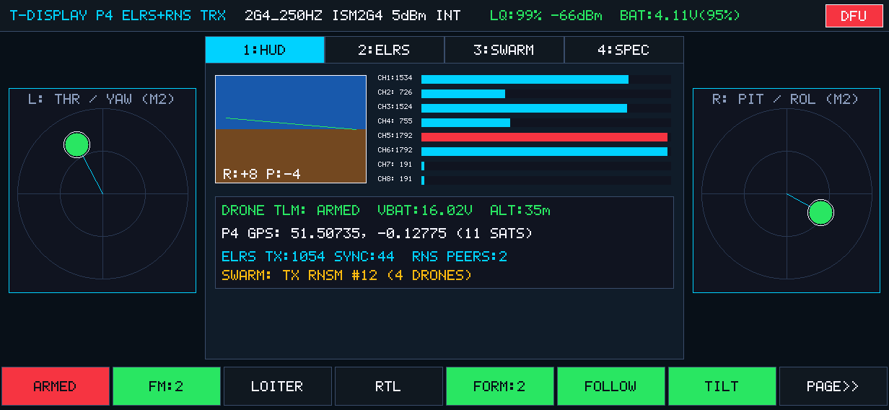
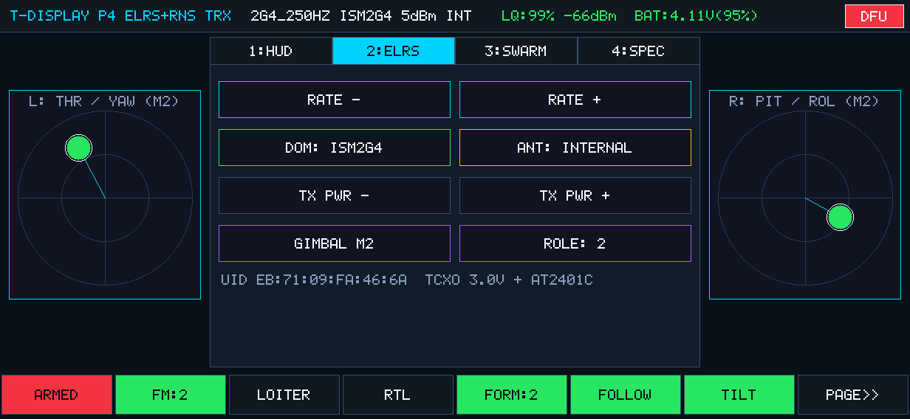
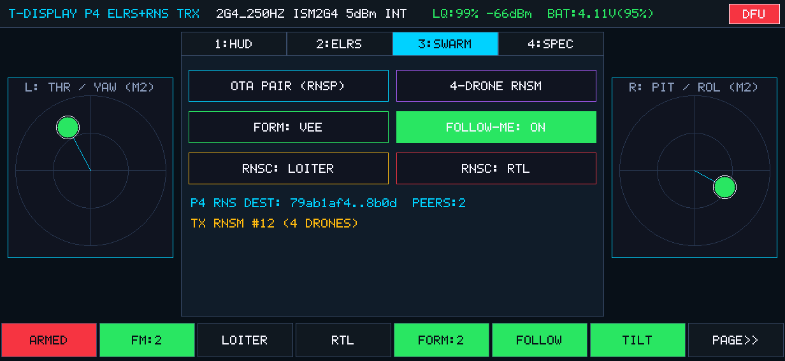
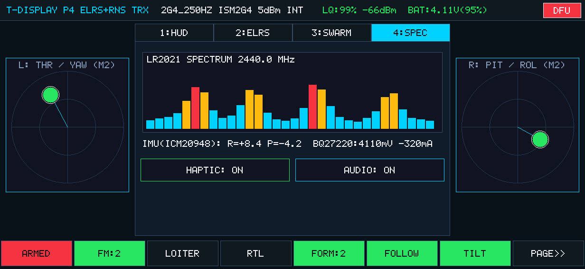
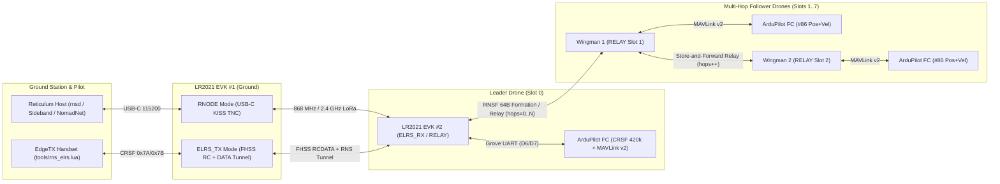

# lr2021-elrs

[](LICENSE)

Dual-band (Sub-GHz + 2.4 GHz) **ExpressLRS v3/v4 RC control**, **Reticulum (`rnsd`) mesh networking**, **RNode KISS TNC**, **ArduPilot MAVLink v2 flight-controller bridge**, and **multi-drone formation flight** firmware for three hardware targets built from a shared C++ protocol core:

1. **[Seeed Studio Semtech LR2021 LoRa Plus Evaluation Kit](https://www.seeedstudio.com/LR2021-LoRa-Plus-Evaluation-kit-868Mhz-EU-V2-0-p-6697.html)** ([915 MHz US](https://www.seeedstudio.com/LR2021-LoRa-Plus-Evaluation-kit-915Mhz-US-V2-0-p-6698.html) / [Seeed Wiki](https://wiki.seeedstudio.com/semtech_lr2021_evk_getting_started/)): `Seeed Studio XIAO nRF54L15` + `Wio-LR2021` transceiver (`ELRS_TX`, `ELRS_RX`, `RNODE`, `RELAY`, `MONITOR`).
2. **[LilyGo T-Display P4](https://lilygo.cc/products/t-display-p4)**: Standalone handheld Drone TRX Unit (`ESP32-P4NRW32` + `1232×568` `RM69A10` AMOLED / `1168×540` `HI8561` TFT multi-touch display + onboard `Semtech LR2021` + `AT2401C` 2.4 GHz FEM + `ICM20948` IMU + `L76K` GNSS + `BQ27220` fuel gauge).
3. **RadioMaster XR4**: True dual-band receiver/mesh bridge (`ESP32-PICO-D4` + `2× Semtech LR1121`) running simultaneous 2.4 GHz `2G4_K1000` ExpressLRS and 868 MHz Reticulum LoRa mesh.

---

## Hero Screenshots

### LilyGo T-Display P4 Standalone Drone TRX Unit (`1232×568` Landscape AMOLED HUD)

<p align="center">
  
</p>

| `2: ELRS` (Air Rate, Domain, Power & Antenna) | `3: SWARM` (`RNSP` Pair, `RNSF` Vee/Line & `RNSM` 4-Drone Bundle) | `4: SPEC` (`LR2021` Spectrum Waterfall, IMU & Fuel Gauge) |
| :---: | :---: | :---: |
|  |  |  |

### Reticulum `RNodeInterface` & Sideband v1.9.8 ↔ 867.2 MHz LoRa ↔ ArduPilot `TMotorH743`

| Announce Discovery (`867.2 MHz`) | Contact & Quadcopter Icon | Bidirectional `rtl` -> `TMotorH743` | Live `TMotorH743` Telemetry |
| :---: | :---: | :---: | :---: |
|  |  |  |  |

---

## What to Expect



### What Works Today
- **ExpressLRS RC & Telemetry (`ELRS_TX`, `ELRS_RX`, `MONITOR`)**: 23 air rates across Sub-GHz (`EU868`, `FCC915`, `AU915`) and 2.4 GHz (`CE_LBT`, `ISM2G4`) using LoRa, FLRC, and GFSK + Hamming(7,4) FEC. Outputs 420,000-baud CRSF `RC_CHANNELS_PACKED` (`0x16`) and `LINK_STATISTICS` (`0x14`) on the Grove UART (`D6`/`D7`).
- **Plug-and-Play Reticulum RNode (`RNODE`)**: Standard RNode KISS TNC over USB-C (`115200 8N1`) for Reticulum (`RNodeInterface`), Sideband, and NomadNet. Supports transparent multi-frame fragmentation up to `RNODE_HW_MTU = 508` bytes.
- **Airborne Mesh Repeater & Flight Controller Bridge (`RELAY`)**: Store-and-forward LoRa repeater with a 64-entry FNV-1a deduplication ring, IFAC tag preservation, and a multi-hop ping-pong test mode (`rns_chain`). Ingests MAVLink v1/v2 telemetry (`HEARTBEAT`, `SYS_STATUS`, `GLOBAL_POSITION_INT`) into `rnlog.beacon` broadcasts and translates Reticulum commands into MAVLink v2 frames (`#70`, `#73`, `#76`, `#84`, `#86`).
- **Reticulum-over-ExpressLRS Tunnel (`ELRS_PKT_TYPE_DATA`)**: Multiplexes Reticulum packets up to 500 bytes across active 200 Hz / 1000 Hz ExpressLRS FHSS links without needing a second radio.
- **EdgeTX Handset Tool ([`tools/rns_elrs.lua`](tools/rns_elrs.lua))**: 4-page handset UI (`480x272` ColorLCD and `128x64` B&W) for over-the-air Reticulum pairing (`RNSP`), LoRa configuration, peer selection, targeted drone commands (`RNSC`), and swarm formation triggers (`[Form:VEE]`, `[Form:LINE]`, `[Form:HOLD]`).
- **Multi-Drone Formation (`RNSF`) & Multi-Slot Command Bundles (`RNSM`)**: Distributes 64-byte signed formation packets (`VEE`, `LINE`, `COLUMN`, `HOLD`, including periodic `rns_form auto`) and 64-byte 4-slot independent command bundles (`rns_multi` with per-slot `OFS:n,e,d`, `VEL:vn,ve,vd`, `LOITER`, `RTL`, `LAND`, `ARM`, `DISARM`), backed by a 3.0 s dead-man `LOITER` watchdog.
- **Hybrid `ELRS_RX` LoRa Burst & Deterministic Slot-TDMA**: A single-radio Lead Drone in `ELRS_RX` mode can remain phase-locked to a 200 Hz / 1000 Hz ExpressLRS RC link while injecting `~33 ms` 868 MHz LoRa bursts (`BW500 SF7`) into the follower mesh. Followers (`Slots 1..7`) relay swarm packets in non-overlapping `(slot_id - 1) × 45 ms` TDMA windows to avoid half-duplex collisions.
- **Unified RadioMaster XR4 (`ESP32-PICO-D4 + 2× Semtech LR1121`) Target**: Builds from the same protocol tree via PlatformIO (`pio run -e radiomaster_xr4`), dedicating **Radio 1 (`LR1121 #1`)** full-time to 2.4 GHz `2G4_K1000` ExpressLRS and **Radio 2 (`LR1121 #2`)** full-time to the 868 MHz Reticulum LoRa mesh with zero time-slicing.
- **LilyGo T-Display P4 Standalone Drone TRX Unit (`ESP32-P4NRW32 + MIPI-DSI Touch + Semtech LR2021`)**: Turns the LilyGo T-Display P4 (`targets/t_display_p4/` + `firmware/p4_trx/`) into a handheld Landscape (`1232×568` RM69A10 AMOLED / `1168×540` HI8561 TFT) ExpressLRS + Reticulum Swarm transmitter with dual multi-touch virtual gimbals (Modes 1–4), 8 auxiliary switches, `ICM20948`/`QMI8658` IMU tilt-to-steer, `L76K` GNSS "Follow-Me" formation leader broadcasts (`RNSF`/`RNSM`), `BQ27220` fuel-gauge telemetry, `AW86224` haptics, and dual-band (`AT2401C` 2.4 GHz + Sub-GHz) `LR2021` RF output.

### Hardware & Radio Constraints
- **Single Transceiver (`Wio-LR2021`) vs Dual Transceiver (`RadioMaster XR4 2× LR1121`)**: Each `Wio-LR2021` board has one PLL/baseband path, so `ELRS_RX` bridges to the 868 MHz LoRa mesh by time-slicing brief LoRa bursts while `TIMER20` tracks `OtaNonce` and `FHSS` hops in the background. On the **RadioMaster XR4** target (`2× LR1121`), Radio 1 stays on 2.4 GHz ELRS continuously while Radio 2 runs 868 MHz Reticulum LoRa mesh simultaneously.
- **Half-Duplex Relay Cadence**: At `868 MHz, BW = 500 kHz, SF7` (`~33 ms` Time-on-Air per 64B `RNSF`/`RNSM` packet), deterministic `45 ms` Slot-TDMA windows let a multi-drone chain relay without collisions at `2–4 Hz`.
- **Oscillator & RF Limits**: The Wio-LR2021 uses a passive 32 MHz crystal (never send `SET_TCXO_MODE 0x0120`), and maximum RF input at `ANT_LF`/`ANT_HF` is `+10 dBm`. Always attach antennas before transmitting.

---

## Build, Test & Flash

### 1. Build Firmware (`XIAO nRF54L15 + Wio-LR2021`, `RadioMaster XR4`, & `LilyGo T-Display P4`)
```bash
# Build XIAO nRF54L15 + Wio-LR2021 firmware (arm-none-eabi-gcc 12+, cmake 3.20+)
cmake -B build -DCMAKE_TOOLCHAIN_FILE=firmware/toolchain-arm-none-eabi.cmake -DCMAKE_BUILD_TYPE=Release
cmake --build build -j$(nproc)

# Build RadioMaster XR4 (ESP32-PICO-D4 + 2x LR1121) firmware (PlatformIO)
pio run -e radiomaster_xr4

# Build LilyGo T-Display P4 (ESP32-P4NRW32 + MIPI-DSI + LR2021) firmware (ESP-IDF v5.4+)
ninja -C targets/t_display_p4/build
```

### 2. Run Host Unit Tests (15 Suites, Including Embedded Lua 5.2 VM, Dual-LR1121 XR4, & T-Display P4 TRX)
```bash
mkdir -p build_host
g++ -std=c++17 -O2 -Wall -Wextra -I. \
    -Ifirmware/elrs -Ifirmware/crsf -Ifirmware/rnode -Ifirmware/p4_trx -Ifirmware/radio \
    tests/test_elrs_host.cpp \
    firmware/elrs/elrs_protocol.cpp \
    firmware/crsf/crsf.cpp \
    firmware/rnode/rns_node.cpp \
    firmware/p4_trx/p4_trx_core.cpp \
    firmware/radio/lr1121_driver.cpp \
    -ldl -lm -o build_host/test_elrs_host
./build_host/test_elrs_host
```

### 3. Flash via Onboard CMSIS-DAP (`openocd` 0.12+)
Pass the board's CMSIS-DAP serial number (visible in `ls /dev/serial/by-id/`):
```bash
./scripts/flash.sh FC6D1A37 build/lr2021_elrs.elf
./scripts/flash.sh D56B6941 build/lr2021_elrs.elf
```

---

## Quick Start

### Operating Modes at a Glance

| Mode | CLI Command | Purpose |
|---|---|---|
| `RNODE` | `mode rnode` (or auto on `0xC0`) | USB-C KISS TNC for Reticulum `RNodeInterface`, Sideband, and NomadNet |
| `RELAY` | `mode relay` | Autonomous LoRa mesh repeater + MAVLink flight-controller bridge |
| `ELRS_TX` | `mode tx` | ExpressLRS FHSS transmitter + Reticulum `DATA` uplink tunnel |
| `ELRS_RX` | `mode rx` | ExpressLRS FHSS receiver + 420k CRSF output + Reticulum `DATA` downlink |
| `MONITOR` | `mode monitor` | Passive FHSS sniffer for uplink RC and downlink telemetry |
| `BRIDGE` / `PONG` | `mode bridge` / `pong ...` | Raw FLRC / LoRa packet link and RTT range tester |
| `IDLE` | `mode idle` | Standby (`STDBY_XOSC`) and spectral RSSI sweep (`scan 900`, `scan 2400`) |

### Common Recipes

1. **Reticulum `RNodeInterface` + Airborne Repeater (`868 MHz`)**:
   ```bash
   # Configure airborne board as a Reticulum relay + MAVLink bridge
   ./tools/lr2021_cli.py -p /dev/ttyACM7 rnode-cfg --freq 867200000 --bw 125000 --sf 7 --cr 5
   ./tools/lr2021_cli.py -p /dev/ttyACM7 configure --mode relay
   ```
2. **Reticulum-over-ExpressLRS FHSS Tunnel (`EU868 200 Hz`)**:
   ```bash
   ./tools/lr2021_cli.py -p /dev/ttyACM7 configure --phrase "lr2021-elrs-demo" --domain eu868 --rate 900_200HZ --mode rx
   ./tools/lr2021_cli.py -p /dev/ttyACM5 configure --phrase "lr2021-elrs-demo" --domain eu868 --rate 900_200HZ --mode tx
   ./tools/lr2021_cli.py -p /dev/ttyACM5 rns-pair --ifac elrs-mesh
   ./tools/lr2021_cli.py -p /dev/ttyACM5 rns-to sel PING
   ```
3. **Multi-Drone Formation Flight with ArduCopter SITL (`anisoptera`)**:
   ```bash
   /home/ian/Code/anisoptera/.venv/bin/python tools/rns_multi_drone_sitl.py
   ```

---

## Documentation

Detailed reference material is split into three documents under [`docs/`](docs/):

- **[CLI, EdgeTX Lua & Multi-Drone Formation Guide](docs/CLI_AND_LUA_GUIDE.md)**: USB serial CLI command reference (`115200 8N1`), EdgeTX handset tool ([`tools/rns_elrs.lua`](tools/rns_elrs.lua)) setup and pages, multi-drone formation commands (`rns_slot`, `rns_form`), and the multi-hop ping-pong relay test chain (`rns_chain`).
- **[Hardware & Protocol Architecture](docs/HARDWARE_AND_PROTOCOL.md)**: XIAO nRF54L15 to Wio-LR2021 pinout, timer/clock domains, LR2021 Rev B (`0x0118`) register notes, ExpressLRS OTA4/OTA8 and Hamming(7,4) FEC internals, and Reticulum/MAVLink packet layouts (`RNSA`, `RNSP`, `RNSC`, `RNSF`, `#84`, `#86`).
- **[Hardware & SITL Verification Results](docs/VERIFICATION.md)**: Bench and RF logs across the two LR2021 EVKs, live `TMotorH743` flight controller, Sideband v1.9.8 screenshots, RadioMaster TX16S MK3 / XR4 `2G4_K1000` capture, and 2-drone ArduCopter SITL formation flight.

---

## License

Licensed under the GNU Affero General Public License v3.0 or later (`SPDX-License-Identifier: AGPL-3.0-or-later`). See [LICENSE](LICENSE).

Portions of the radio register definitions, PRAM patch image, and ExpressLRS OTA/FHSS/CRSF protocol logic are adapted from ExpressLRS (`GPL-3.0-or-later`), Semtech `lr20xx_driver` (`BSD-3-Clause`), and Nordic Semiconductor `nrfx` / MDK headers (`BSD-3-Clause`).
