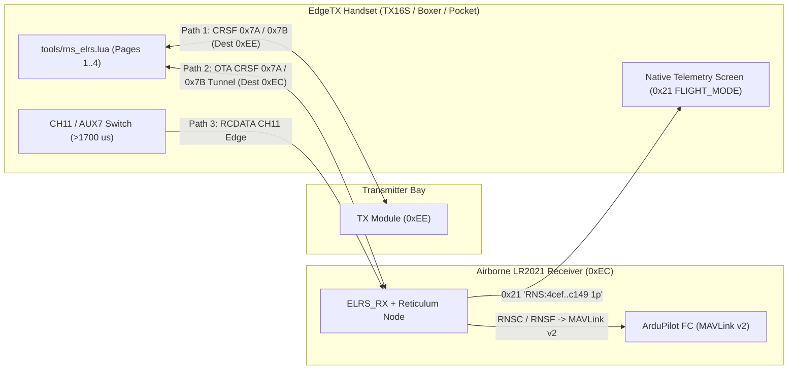
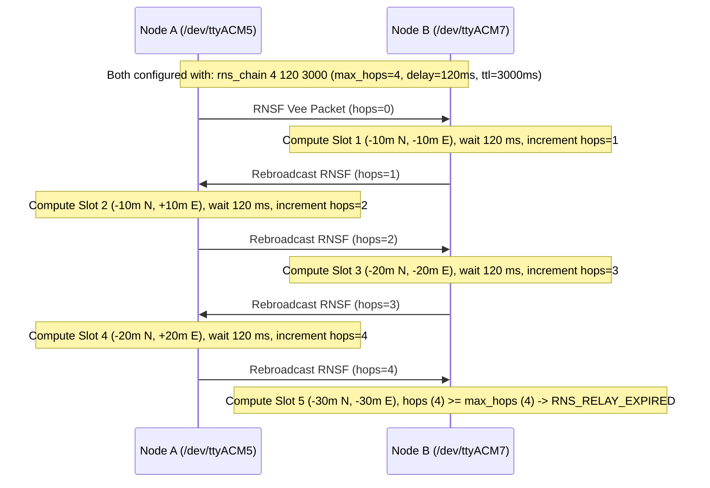

# CLI, EdgeTX Lua & Multi-Drone Formation Guide

This guide covers the USB serial CLI (`115200 8N1`), the EdgeTX handset script ([`tools/rns_elrs.lua`](../tools/rns_elrs.lua)), and the multi-drone Reticulum formation and relay chain commands.

---

## 1. Serial Console Commands (`115200 8N1`)

Connect to the board's USB-C port (`/dev/ttyACM*`) with any terminal (`picocom -b 115200 /dev/ttyACM5`) or via [`tools/lr2021_cli.py`](../tools/lr2021_cli.py).

### Radio & ExpressLRS Commands

| Command | Description |
|---|---|
| `help` | List available CLI commands |
| `status` | Print radio mode, FHSS lock, packet counters, RSSI/SNR, RC channels, and Reticulum counters |
| `rates` | List all 23 supported ExpressLRS air rates (`Sub-GHz` and `2.4 GHz`) |
| `phrase <binding_phrase>` | Derive 6-byte ExpressLRS UID from a binding phrase (MD5) |
| `uid <XX:XX:XX:XX:XX:XX>` | Set the 6-byte ExpressLRS UID directly |
| `domain <fcc915\|au915\|eu868\|ism2g4\|ce_lbt>` | Set the regulatory frequency domain |
| `rate <idx_or_name>` | Select ExpressLRS air rate by index (`0..22`) or name (e.g. `900_200HZ`, `2G4_K1000`) |
| `power <dbm>` | Set TX output power in dBm (`-20..22` Sub-GHz, `-20..12` 2.4 GHz) |
| `mode <idle\|tx\|rx\|monitor\|bridge\|rnode\|relay>` | Switch operating mode |
| `rc <ch1_us> [ch2_us .. ch16_us]` | Set uplink RC channels in microseconds (`988..2012`) |
| `ping <freq_hz> <lora\|flrc> [count]` | Transmit `count` ping packets and measure `PONG` RTT, RSSI, and SNR |
| `pong <freq_hz> <lora\|flrc>` | Listen on `freq_hz` and auto-reply with `PONG` |
| `txpkt <hex_bytes>` | Transmit raw payload bytes in `BRIDGE` mode |
| `scan <900\|2400>` | Sweep instantaneous RSSI across the Sub-GHz or 2.4 GHz band |

### Reticulum, MAVLink & Multi-Drone Commands

| Command | Description |
|---|---|
| `rnode_cfg [freq_hz] [bw_hz] [sf] [cr]` | Set RNode / Relay LoRa parameters (e.g. `rnode_cfg 868000000 500000 7 5`) |
| `rns_id` | Print this node's hardware ID, 16-byte Reticulum `SINGLE` destination hash, and identity hash |
| `rns_ann` | Broadcast a signed 68-byte Reticulum node announce (`RNSA`) |
| `rns_pair [ifac_pass\|off]` | Over-the-air Reticulum pairing (`RNSP`): pushes RF and IFAC config to bound RX |
| `rns_peers [select <idx>]` | List discovered Reticulum peers (`0..7`) or select the active target peer |
| `rns_to <dest_hex\|sel\|bcast> <cmd>` | Send a targeted command (`PING`, `LOITER`, `RTL`, `LAND`, `ARM`, `DISARM`, `GOTO ...`) to a specific 16B RX address (`RNSC`) |
| `rns_cmd <cmd>` | Broadcast a drone command to `elrs.drone.cmd` (`GOTO lat lon alt`, `VEL vn ve vd [yr]`, `BVL vx vy vz [yr]`, `RTL`, `LOITER`, `LAND`, `ARM`, `DISARM`, `MODE n`, `RC c1 c2 c3 c4`) |
| `rns_slot <0..7>` | Set formation slot (`0` = Leader, `1` = Left Wingman 1, `2` = Right Wingman 1, ...) |
| `rns_form <vee\|line\|col\|hold\|auto> [spacing_m] [vn_ms] [ve_ms] [hdg_deg]` | Broadcast a 64-byte signed formation packet (`RNSF`) or enable periodic auto-broadcast (`rns_form auto vee 10.0 500`) |
| `rns_multi <s1_spec> [s2_spec] [s3_spec] [s4_spec]` | Broadcast a 64-byte multi-drone command bundle (`RNSM`) driving up to 4 independent slots (`OFS:n,e,d`, `VEL:vn,ve,vd`, `LOITER`, `RTL`, `LAND`, `ARM`, `DISARM`, `NOP`) |
| `rns_chain <off\|max_hops> [delay_ms] [ttl_ms]` | Enable or disable multi-hop ping-pong relay chain test mode with hop and TTL expiration |
| `bcn [now\|interval_ms]` | Broadcast an immediate `rnlog.beacon` JSON telemetry packet or set periodic interval in ms |
| `fc_sim <lat_e7> <lon_e7> <alt_m> <vbatt_mv>` | Set simulated flight controller GPS and battery state |
| `mav_rx <hex_bytes>` | Feed raw MAVLink v1/v2 frame bytes into the flight controller telemetry parser |
| `rns_tx <hex_bytes>` | Send raw Reticulum packet bytes over LoRa (`RELAY`/`RNODE`) or the ExpressLRS `DATA` tunnel |
| `crsf_lua <status\|peer\|ann\|pair\|ping\|loiter\|rtl>` | Test the local EdgeTX Lua CRSF `0x7A`/`0x7B` handler |
| `crsf_ota <status\|peer\|ann\|pair\|ping\|loiter\|rtl>` | Tunnel a CRSF `0x7A` command over the air to the bound receiver (`0xEC`) |

---

## 2. EdgeTX Handset Script ([`tools/rns_elrs.lua`](../tools/rns_elrs.lua))

Copy [`tools/rns_elrs.lua`](../tools/rns_elrs.lua) to `/SCRIPTS/TOOLS/rns_elrs.lua` on your EdgeTX SD card and open **RNS-ELRS Mesh** from `SYS -> Tools`. Both `480x272` ColorLCD handsets (RadioMaster TX16S MK3) and `128x64` monochrome handsets (Boxer, Pocket, Zorro) are supported.

### Wire-Free Operation Modes

1. **Local TX Module (`[TX-MOD(0xEE)]`)**: Sends CRSF `0x7A` commands to an LR2021 module in the handset bay or attached via USB-C.
2. **Over-the-Air Receiver (`[OTA-RX(0xEC)]`)**: Tunnels CRSF `0x7A` commands over the ExpressLRS FHSS link directly to a bound LR2021 receiver (`ELRS_RX`) and returns `0x7B` responses over telemetry slots.
3. **RC Switch Trigger (`CH11` / `AUX7`)**: Flipping `CH11` high on any bound handset triggers the receiver to broadcast a signed `RNSA` announce and send a CRSF `0x21` `FLIGHT_MODE` string (`RNS:4cef..c149 1p`) to the handset telemetry screen.



### Pages

- **Page 1 (Identity & Pairing)**: Shows `tx_dest`, `rx_dest`, link lock, peer count, ping RTT, and native `0x21` flight mode text. Includes `[Pair & Sync RX]`, `[Announce]`, and target toggle (`0xEE` vs `0xEC`).
- **Page 2 (RNode LoRa Config)**: Edit frequency (`868.000`, `869.525`, `915.000`, `2440.000 MHz`), bandwidth (`125`, `250`, `500`, `812.5 kHz`), spreading factor (`SF5..SF12`), coding rate (`4/5..4/8`), TX power (`-9..22 dBm`), and `IFAC`, then push OTA to the receiver.
- **Page 3 (Mesh Peers)**: Polls up to 8 discovered Reticulum peers showing hop count, RSSI, SNR, and battery voltage. Press `ENTER` to select a peer as the active command target.
- **Page 4 (Targeted RX Cmd & Swarm Formation)**: Sends `[Ping RX]`, `[LOITER]`, `[RTL]`, `[LAND]`, `[ARM]`, or `[DISARM]` addressed to the selected receiver's 16-byte Reticulum destination hash (`RNSC`), or triggers `[Form:VEE]`, `[Form:LINE]`, and `[Form:HOLD]` swarm formation broadcasts (`RNSF`).

---

## 3. Multi-Drone Formation & Ping-Pong Relay Chain

### Flying a Vee Formation with ArduCopter SITL (`anisoptera`)

Run [`tools/rns_multi_drone_sitl.py`](../tools/rns_multi_drone_sitl.py) with two connected LR2021 boards (`/dev/ttyACM5` and `/dev/ttyACM7`) and an ArduCopter SITL binary (`/home/ian/Code/ardupilot/build/sitl/bin/arducopter`):

```bash
/home/ian/Code/anisoptera/.venv/bin/python tools/rns_multi_drone_sitl.py
```

What the harness runs:
1. Spawns two ArduCopter SITL instances (`-I0` Leader on TCP `5760`, `-I1` Wingman on TCP `5770`), switches both to `GUIDED`, arms, and takes off to `15 m` AGL.
2. Feeds Leader GPS and velocity into Board 1 (`/dev/ttyACM5`, Slot 0), which broadcasts 64-byte signed `RNSF` Vee-formation packets over 868 MHz LoRa (`500 kHz` BW, `SF7`).
3. Board 2 (`/dev/ttyACM7`, Slot 1) receives the `RNSF` packets over RF, computes its Slot 1 Vee offset (`10 m` South, `10 m` West of Leader + velocity feed-forward), emits 65-byte MAVLink v2 `SET_POSITION_TARGET_GLOBAL_INT` (`#86`) frames to Wingman 1 SITL, and relays the packet (`hops = 0 -> 1`).
4. Silences Leader RF for `3.3 s` and verifies that Board 2 fires `RNS_MESH_FAILSAFE action=LOITER timeout_ms=3000`, braking Wingman 1 in `LOITER`.

### Testing a Multi-Hop Relay Chain with Two Boards (`rns_chain`)

To test multi-hop propagation and packet expiration across two physical radios without needing 5+ boards:

```text
# On both /dev/ttyACM5 and /dev/ttyACM7:
rnode_cfg 868000000 500000 7 5
mode relay
rns_chain 4 120 3000

# On /dev/ttyACM5 (Node A), send one formation packet:
rns_form vee 10.0 5.0 0.0 0.0
```

The packet bounces between Node B and Node A (`hops = 0 -> 1 -> 2 -> 3 -> 4`) with a `120 ms` turn-around delay at each hop, computing formation slots `1..5` along the chain, and expires on Node B when `hops == 4` (`RNS_RELAY_EXPIRED hops=4 max_hops=4 ttl_ms=3000`) or when `ttl_ms` elapses. Run `rns_chain off` to return to normal deduplicating relay mode.


