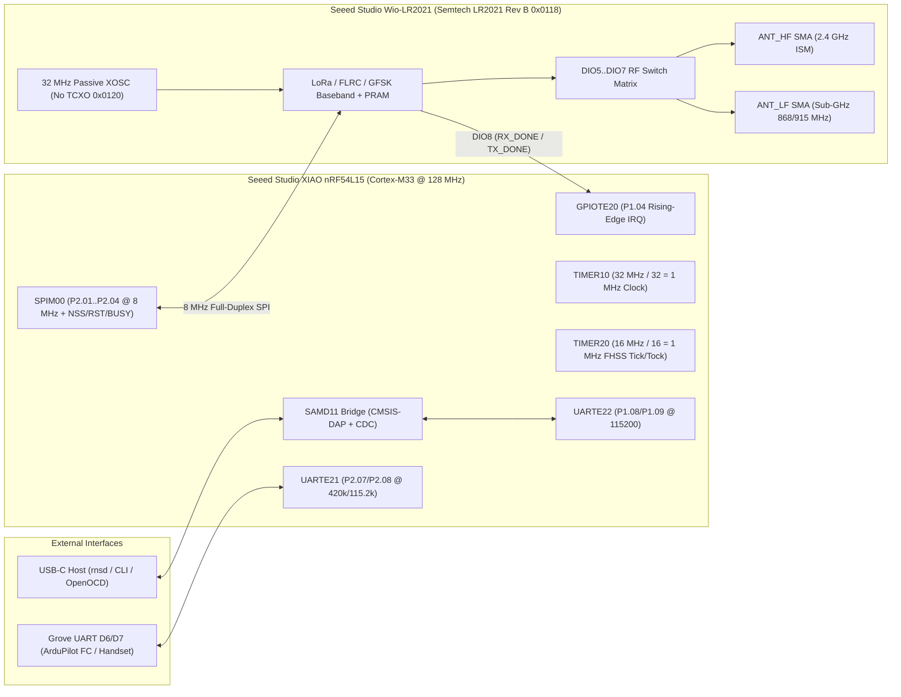
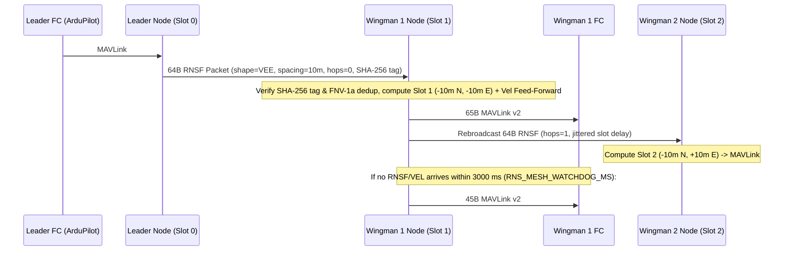
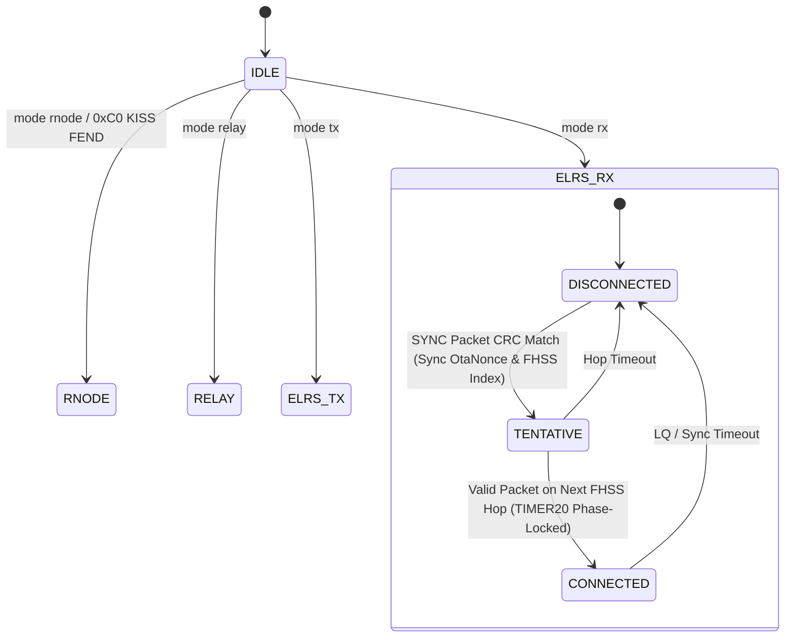
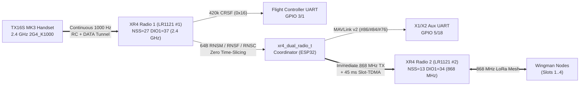

# Hardware & Protocol Architecture

This document covers the hardware interface on the [Seeed Studio Semtech LR2021 LoRa Plus Evaluation Kit](https://www.seeedstudio.com/LR2021-LoRa-Plus-Evaluation-kit-868Mhz-EU-V2-0-p-6697.html) ([915 MHz US](https://www.seeedstudio.com/LR2021-LoRa-Plus-Evaluation-kit-915Mhz-US-V2-0-p-6698.html) / [Seeed Wiki](https://wiki.seeedstudio.com/semtech_lr2021_evk_getting_started/), `LR2021EVK1XBS1_XIAO`), the Semtech LR2021 Rev B (`0x0118`) initialization sequence, the ExpressLRS OTA4/OTA8 packet and FHSS engines, the Reticulum `RNode` KISS / airborne relay / MAVLink bridge / ExpressLRS `DATA` tunnel architecture, and the USB CDC CLI protocol.

---

## 1. Hardware Architecture (`XIAO nRF54L15` + `Wio-LR2021`)



### 1.0 Pin Mapping & RF Limits

- **Evaluation Kit**: [Seeed Studio Semtech LR2021 LoRa Plus Evaluation Kit (868 MHz EU)](https://www.seeedstudio.com/LR2021-LoRa-Plus-Evaluation-kit-868Mhz-EU-V2-0-p-6697.html) / [915 MHz US](https://www.seeedstudio.com/LR2021-LoRa-Plus-Evaluation-kit-915Mhz-US-V2-0-p-6698.html) ([Seeed Wiki](https://wiki.seeedstudio.com/semtech_lr2021_evk_getting_started/))
- **MCU Board**: Seeed Studio XIAO nRF54L15 (`nRF54L15-QFAA`, ARM Cortex-M33 @ 128 MHz, 1.5 MB RRAM, 256 KB SRAM)
- **Radio Board**: [Seeed Studio Wio-LR2021](https://www.seeedstudio.com/Seeed-Studio-Wio-LR2021-Wireless-module-868-915MHz-Tape-reel-p-6831.html) (`LR2021EVK1XBS1_XIAO`, Semtech LR2021 Rev B `0x0118`)
- **Oscillator**: Passive 32 MHz crystal (`has_tcxo = false`). Do not send `SET_TCXO_MODE` (`0x0120`) on this board; it disables the crystal oscillator and raises `HF_XOSC_START_ERR` (`0x0001`).
- **RF Input Limit**: Maximum +10 dBm at the SMA ports (`ANT_LF` and `ANT_HF`). Attach antennas before transmitting.

| Function | XIAO Pin | nRF54L15 GPIO | Peripheral / Notes |
|---|---|---|---|
| `SPI_SCK` | `D8` | `P2.01` | `SPIM00` @ 8 MHz |
| `SPI_MOSI` | `D10` | `P2.02` | `SPIM00` |
| `SPI_MISO` | `D9` | `P2.04` | `SPIM00` |
| `RADIO_NSS` | `D3` | `P1.07` | Active-low chip select |
| `RADIO_RST` | `D2` | `P1.06` | Active-low reset |
| `RADIO_BUSY` | `D1` | `P1.05` | Active-high busy input |
| `RADIO_IRQ` (`DIO8`) | `D0` | `P1.04` | `GPIOTE20` rising-edge interrupt |
| `USB_CDC_TX` | SAMD11 bridge | `P1.09` | `UARTE22` @ 115200 8N1 |
| `USB_CDC_RX` | SAMD11 bridge | `P1.08` | `UARTE22` @ 115200 8N1 |
| `CRSF_TX` / `FC_TX` | `D6` (Grove TX) | `P2.08` | `UARTE21` @ 420000 / 115200 8N1 (to FC RX) |
| `CRSF_RX` / `FC_RX` | `D7` (Grove RX) | `P2.07` | `UARTE21` @ 420000 / 115200 8N1 (from FC TX or Handset) |
| `USER_LED` | Built-in | `P2.00` | Active-low status LED |
| `USR_BTN` | Built-in | `P0.00` | Active-low user button |

### 1.1 MCU Clock and Timer Domains

The Nordic `nRF54L15` runs on its 128 MHz CPU clock with three separate peripheral domains (`PERI00`, `PERI10`, `PERI20`), each clocked differently:

| Peripheral | Base Address | Bus Clock | Prescaler | Resolution | Role in Firmware |
|---|---|---|---|---|---|
| `SPIM00` | `0x5004A000` | 128 MHz (`PCLK128M`) | `/16` -> 8 MHz SCK | 125 ns/bit | Full-duplex SPI to `Wio-LR2021` on `P2.01..P2.04` (264-byte DMA buffers) |
| `TIMER10` | `0x50085000` | 32 MHz (`PCLK32M`) | `PRESCALER = 5` (`2^5 = 32`) | 1.0 µs/tick | Free-running 32-bit monotonic microsecond clock (`hal_micros()`) |
| `TIMER20` | `0x500CE000` | 16 MHz (`PCLK16M`) | `PRESCALER = 4` (`2^4 = 16`) | 1.0 µs/tick | Phase-lockable ExpressLRS tick/tock hardware timer (`TIMER20_IRQn`) |
| `UARTE22` | `0x500D6000` | 16 MHz (`PCLK16M`) | `BAUDRATE = 0x01D60000` | 115200 8N1 | USB CDC UART via onboard SAMD11 CMSIS-DAP bridge (`P1.08` RX / `P1.09` TX) |
| `UARTE21` | `0x500C7000` | 16 MHz (`PCLK16M`) | `BAUDRATE = 0x06B85000` (420k) | 420000 / 115200 8N1 | External Grove UART (`P2.08` TX / `P2.07` RX) for CRSF & Flight Controller MAVLink |
| `GPIOTE20` | `0x500DA000` | 16 MHz (`PCLK16M`) | — | Rising edge | `DIO8` (`P1.04`) hardware interrupt (`GPIOTE20_0_IRQn`) |

> **Note on `TIMER10` vs `TIMER20`:** `TIMER10` sits on the `PERI10` 32 MHz bus (`PCLK32M`), so a 1 MHz tick requires `PRESCALER = 5` (`32 MHz / 32 = 1 MHz`). `TIMER20` sits on the `PERI20` 16 MHz bus (`PCLK16M`), so a 1 MHz tick requires `PRESCALER = 4` (`16 MHz / 16 = 1 MHz`).

### 1.2 Semtech LR2021 Rev B (`0x0118`) Initialization & LoRa Explicit Header Mode

The `Wio-LR2021` module on the Seeed EVK uses two hardware configurations that differ from generic Semtech reference boards:

1. **Passive 32 MHz Crystal (`XOSC`), No TCXO:**
   Calling `SET_TCXO_MODE` (`0x0120`) shuts down the crystal oscillator and leaves the chip unable to lock its PLL (`HF_XOSC_START_ERR = 0x0001`). Do **not** issue `0x0120` on the Wio-LR2021 EVK.
2. **DIO5..DIO7 External RF Switch Matrix:**
   `SET_DIO_FUNCTION` (`0x0112`) and `SET_DIO_RF_SWITCH_CFG` (`0x0113`) configure `DIO5` (`0x0B`), `DIO6` (`0x0C`), and `DIO7` (`0x03`) for the Sub-GHz and 2.4 GHz front-end switch paths, while `DIO8` (`P1.04`) is configured as the active-high hardware interrupt line (`RX_DONE = 1 << 18`, `TX_DONE = 1 << 19`).
3. **LoRa Explicit Header vs Implicit Header Mode:**
   - ExpressLRS LoRa modes use **implicit header** (`LR2021_LORA_PACKET_IMPLICIT = 0x01`) with fixed 8-byte (`OTA4`) or 13-byte (`OTA8`) payloads and OTA payload CRC14/CRC16.
   - Reticulum `RNODE` and `RELAY` modes use **explicit header** (`LR2021_LORA_PACKET_EXPLICIT = 0x00`), hardware CRC16 (`crc_en = true`), private LoRa syncword `0x12`, and dynamic RX length extraction from `GET_LORA_PACKET_STATUS` (`0x022A`, `status_raw[3]`).
   - In the LR2021 32-bit IRQ register (`ral_lr20xx_convert_irq_flags_to_ral`), bit 5 (`0x00020`) is `PBL_DET` (Preamble Detected), bit 6 (`0x00040`) is `SYNC_WORD_OR_HDR_VALID`, bit 9 (`0x00200`) is `RX_HDR_ERROR`, bit 18 (`0x40000`) is `RX_DONE`, bit 19 (`0x80000`) is `TX_DONE`, bit 21 (`0x200000`) is `TIMEOUT`, and bit 22 (`0x400000`) is `RX_CRC_ERROR`. Explicit-header LoRa reception checks bits 9 (`RX_HDR_ERROR`) and 22 (`RX_CRC_ERROR`) to reject corrupted packets before reading `READ_RX_FIFO` (`0x0001`).

---

## 2. Reticulum / RNode & Airborne Drone Architecture (`firmware/rnode/`)

### 2.1 System Topologies

The firmware supports two complementary architectures for Reticulum drone communications, plus cross-link forwarding between the ExpressLRS FHSS tunnel and the LoRa store-and-forward relay:

```mermaid
flowchart TD
    subgraph TopoA["Topology A: Dedicated RNode + Airborne Store-and-Forward Relay"]
        HOST["Host rnsd / Sideband / NomadNet"] <-->|"USB KISS (FEND 0xC0, MTU 508B)"| RNODE["EVK #1: RNODE Mode"]
        RNODE <-->|"868 MHz / 2.4 GHz Explicit-Header LoRa"| RELAY["EVK #2 on Drone: RELAY Mode"]
        RELAY -->|"64-Entry FNV-1a Dedup + IFAC-Safe Rebroadcast"| MESH["Downstream Follower Drones (Slots 1..7)"]
        RELAY <-->|"Grove UART MAVLink v2 (#0, #1, #33 / #70, #73, #76, #84, #86)"| FC_A["ArduPilot Flight Controller"]
    end

    subgraph TopoB["Topology B: Reticulum-over-ExpressLRS FHSS Tunnel"]
        GS["Ground Station / EdgeTX Handset"] -->|"CRSF / CLI"| ELRS_TX["EVK #1: ELRS_TX Mode"]
        ELRS_TX <-->|"FHSS: Even Nonces = RCDATA/SYNC, Odd Nonces = DATA Tunnel"| ELRS_RX["EVK #2: ELRS_RX Mode"]
        ELRS_RX -->|"420k CRSF RC (0x16) + Link Stats (0x14)"| FC_B["ArduPilot Flight Controller"]
        ELRS_RX -->|"Reassembled RNS Packet -> MAVLink v2 / Relay"| FC_B
    end
```



### 2.2 RNode KISS Protocol (`RNODE` Mode)

`firmware/rnode/rns_node.cpp` implements the RNode KISS state machine (`FEND=0xC0`, `FESC=0xDB`, `TFEND=0xDC`, `TFESC=0xDD`):
- **Handshake & Identity:** Responds to `CMD_DETECT` (`0x08` with `0x73`) -> `0x46` (`RNODE_DETECT_RESP`), `CMD_FW_VERSION` (`0x14`) -> `1.63`, `CMD_PLATFORM` (`0x48`) -> `0xF0`, `CMD_MCU` (`0x49`) -> `0x81`, and `CMD_BOARD` (`0x47`) -> `0x4C`.
- **Radio Configuration & CSMA Timing:** Handles `CMD_FREQUENCY` (`0x01`), `CMD_BANDWIDTH` (`0x02`), `CMD_TXPOWER` (`0x03`), `CMD_SF` (`0x04`), `CMD_CR` (`0x05`), `CMD_RADIO_STATE` (`0x06`), `CMD_ST_ALOCK` (`0x0B`), and `CMD_LT_ALOCK` (`0x0C`). Computes and reports the 12-byte `CMD_STAT_PHYPRM` (`0x26`) CSMA/CA parameters (`symbol_time_ms`, `symbol_rate`, `preamble_symbols`, `preamble_ms`, `csma_slot_ms`, `csma_difs_ms`).
- **Packet Data & Flow Control:** Accepts variable-length Reticulum packets up to 255 bytes on `CMD_DATA` (`0x00`), transmits over the LR2021, and returns `CMD_READY` (`0x0F`, `0x01`) upon `TX_DONE`. On receive, emits `CMD_STAT_RSSI` (`0x23`, `rssi_dbm + 157`), `CMD_STAT_SNR` (`0x24`, `snr_q2`), and `CMD_DATA` (`0x00`).

### 2.3 Airborne Store-and-Forward Relay (`RELAY` Mode)

When operating in `RELAY` mode on the drone:
1. **Invariant Packet Hash Deduplication (`rns_relay_compute_hash()`):** Computes a 32-bit FNV-1a hash over the Reticulum packet while masking out the mutable `hops` byte (`pkt[1]`) on unauthenticated frames. Stores the hash and reception timestamp in a 64-entry ring buffer with a 10,000 ms suppression window (`RNS_RELAY_DEDUP_WINDOW_MS`). This prevents the relay from re-broadcasting its own echo or looping packets.
2. **IFAC (Interface Authentication Code) Preservation:** If bit 7 of the header flags (`pkt[0] & 0x80`) is set, the relay forwards the packet **without modifying `pkt[1]`**. This preserves the cryptographic IFAC tag across the hop. If `IFAC == 0`, the relay increments `pkt[1]` (`hops++`) up to `RNS_MAX_HOPS` (`128`).

### 2.4 Flight Controller MAVLink v2 Bridge & Telemetry Beacons

- **Downlink Telemetry Beacons (`rnlog.beacon`, Destination Hash `18bcd8a3dea16ef6765c6b27d008d220`):**
  A zero-dependency streaming MAVLink v1/v2 parser (`rns_mav_parser_feed_byte()`) decodes `HEARTBEAT` (`#0`), `SYS_STATUS` (`#1`), and `GLOBAL_POSITION_INT` (`#33`) from the `TMotorH743` flight controller. It formats compact Reticulum broadcast packets:
  ```json
  {"src":"lr2021-drone","lat":0.00000,"lon":0.00000,"alt_m":120,"vbatt_mv":24800,"mode":0,"armed":0,"lq":100,"rssi":-95}
  ```
- **Uplink Drone Commands (`elrs.drone.cmd`, Destination Hash `734547db63023618ae2bd9a65187bafc`):**
  Incoming Reticulum packets addressed to `RNS_DEST_DRONE_CMD` are parsed by `rns_parse_drone_command_pkt()` and converted by `rns_build_mavlink_command()` into standard MAVLink v2 frames (with X.25 CRC-16/MCRF4XX and `CRC_EXTRA`) written to the flight controller UART:
  - `GOTO <lat_e7> <lon_e7> <alt_m>` -> 49-byte MAVLink v2 `MISSION_ITEM_INT` (`msgid = 73`, `MAV_CMD_NAV_WAYPOINT = 16`, `current = 2` guided mode target, `frame = MAV_FRAME_GLOBAL_RELATIVE_ALT_INT`).
  - `RTL`, `LOITER`, `LAND`, `ARM`, `DISARM`, `MODE <custom_mode>` -> 45-byte MAVLink v2 `COMMAND_LONG` (`msgid = 76`, `MAV_CMD_NAV_RETURN_TO_LAUNCH = 20`, `MAV_CMD_NAV_LOITER_UNLIM = 17`, `MAV_CMD_NAV_LAND = 21`, `MAV_CMD_COMPONENT_ARM_DISARM = 400`, `MAV_CMD_DO_SET_MODE = 176`).
  - `RC <ch1_us> <ch2_us> <ch3_us> <ch4_us>` -> Updates local CRSF RC channels AND emits a 30-byte MAVLink v2 `RC_CHANNELS_OVERRIDE` (`msgid = 70`, `CRC_EXTRA = 124`) frame (`RC 0 0 0 0` releases the MAVLink RC override back to the hardware RC receiver).
  - `VEL <vn_cms> <ve_cms> <vd_cms> [yaw_rate_cdps]` and `BVL <vx_cms> <vy_cms> <vz_cms> [yaw_rate_cdps]` -> 65-byte MAVLink v2 `SET_POSITION_TARGET_LOCAL_NED` (`msgid = 84`, `CRC_EXTRA = 143`, `mask = 0x0DC7` velocity-only or `0x05C7` velocity + yaw rate, `frame = LOCAL_NED (1)` or `BODY_OFFSET_NED (9)`).
- **Multi-Drone Formation Broadcast (`RNSF`, Context `0xA7`, 64 Bytes):**
  - `rns_build_formation_pkt()` packs `[0..18]` Reticulum header (`0x08`, `hops`, `RNS_DEST_DRONE_CMD`, `0xA7`), `[19..22]` `"RNSF"`, `[23..38]` `leader_dest` (16B), `[39]` `seq`, `[40]` `shape` (`HOLD = 0`, `LINE = 1`, `VEE = 2`, `COLUMN = 3`), `[41..42]` `spacing_dm`, `[43..46]` `leader_lat_e7`, `[47..50]` `leader_lon_e7`, `[51..52]` `leader_alt_dm`, `[53..54]` `vx_cms`, `[55..56]` `vy_cms`, `[57..58]` `vz_cms`, `[59..60]` `heading_cdeg`, and `[62..63]` 2-byte SHA-256 tag over bytes `[2..61]`.
  - Followers compute their rotated slot offset via `rns_compute_formation_slot_cmd()` and emit a 65-byte MAVLink v2 `SET_POSITION_TARGET_GLOBAL_INT` (`msgid = 86`, `CRC_EXTRA = 5`, `mask = 0x09C0`, `frame = GLOBAL_RELATIVE_ALT_INT (6)`). A 3.0 s dead-man watchdog (`RNS_MESH_WATCHDOG_MS = 3000`) emits `MAV_CMD_NAV_LOITER_UNLIM` if updates stop.
- **Combined Multi-Drone Command Bundle (`RNSM`, Context `0xA8`, 64 Bytes):**
  - `rns_build_multi_drone_pkt()` packs independent per-slot commands/3D offsets for up to 4 follower slots (`Slots 1..4`) into a single 64-byte frame (`[19..22]` `"RNSM"`, `[23]` `seq`, `[24]` `slot_mask`, `[25..36]` reference `lat_e7`/`lon_e7`/`alt_dm`/`heading_cdeg`, `[37..60]` four 6-byte slot descriptors `[action, n_val_dm, e_val_dm, d_val]`, and `[62..63]` 2-byte SHA-256 tag).
- **Deterministic Slot-TDMA Relay & Hybrid `ELRS_RX` LoRa Burst:**
  - When relaying `RNSF` (`0xA7`) or `RNSM` (`0xA8`) packets, followers in `rns_slot 1..7` schedule their rebroadcast at `(slot_id - 1) * 45 ms` (`rns_relay_compute_slot_delay_ms()`) instead of random CSMA jitter.
  - When a Lead Drone is in `ELRS_RX` mode locked to a 200 Hz FHSS link, `start_elrs_lora_mesh_burst()` injects 64-byte `RNSF`/`RNSM` LoRa bursts onto the 868 MHz mesh while `TIMER20` continues advancing `OtaNonce` and `FHSS` hops in lockstep, immediately restoring FHSS reception on `TX_DONE`.



### 2.5 ExpressLRS `ELRS_PKT_TYPE_DATA` (`0x01`) FHSS Tunnel

To carry Reticulum packets up to 500 bytes across an active ExpressLRS link without a second radio:
- **Framing:** Each `ELRS_PKT_TYPE_DATA` (`pkt[0] & 0x03 == 0x01`) frame carries a 2-byte tunnel header in `pkt[1..2]`:
  - `pkt[1]`: `[7:6] = seq_id (0..3)`, `[5:0] = frag_idx (0..62)`
  - `pkt[2]`:If `frag_idx == 0`: `[7:6] = total_len[9:8]`, `[5:0] = total_frags (1..63)`, and `pkt[3] = total_len[7:0]`. If `frag_idx > 0`: `pkt[2..N]` carries raw fragment data (`5 B` per `OTA4` frame, `10 B` per `OTA8` frame).
- **CRC & Slot Scheduling:** Each frame is protected by the standard ExpressLRS `OtaCrc` (`14-bit` on `OTA4`, `16-bit` on `OTA8`) seeded with the current `OtaNonce`. On uplink (`ELRS_TX`), tunnel fragments are transmitted on odd nonces (`(ota_nonce & 1) != 0`), leaving even nonces for continuous `RCDATA` and `SYNC` frames. On downlink (`ELRS_RX`), tunnel fragments are transmitted on telemetry slots (`ota_nonce % tlm_denom == 0`). Each fragment is transmitted `frag_repeat = 2` times for forward loss recovery without blocking the FHSS timer.

---

## 3. ExpressLRS Protocol Implementation



### 3.1 UID Derivation and CRC Seeds

Binding phrases are hashed with MD5 following the ExpressLRS algorithm (`elrs_uid_from_bind_phrase()` in `firmware/elrs/elrs_protocol.cpp`):

```text
MD5("-DMY_BINDING_PHRASE=\"" + phrase + "\"") -> first 6 bytes = UID[0..5]
```

For `"lr2021-elrs-demo"`, `UID = 6C:40:CF:45:F5:08`:
- **`OtaCrcInitializer` (16-bit):** `((UID[4] << 8) | UID[5]) ^ (OTA_VERSION_ID << 8)` (`0xF108`)
- **`FHSSrandomisr` Seed (32-bit):** `((UID[2] << 24) | (UID[3] << 16) | (UID[4] << 8) | (UID[5] ^ OTA_VERSION_ID)) & 0x7FFFFFFF` (`0x4F45F50C` masked / `0xCF45F50C` raw)

### 3.2 Hamming(7,4) FEC & Bit Interleaver (`2G4_K1000` / `900_K1000`)

In `2G4_K1000` and `900_K1000`, the 8-byte payload of an 8-byte `OTA4` frame over GFSK encodes into 14 air bytes. This uses systematic Hamming(7,4) with a bit interleaver (`fec_encode_8_to_14()` / `fec_decode_14_to_8()` in `firmware/radio/lr2021_driver.cpp`):
1. The low and high nibbles of each byte (`n0..n15`) map through `k_hamming_enc[16]` into sixteen 7-bit codewords.
2. Bits `0..6` across groups of 8 codewords transpose into 14 interleaved air bytes. A burst error of up to 8 consecutive air bits flips at most 1 bit in any single 7-bit codeword.
3. On receive, `fec_decode_14_to_8()` de-interleaves the 14 air bytes and corrects single-bit errors per codeword via `k_hamming_dec[128]`.

---

## 9. RadioMaster XR4 (`ESP32-PICO-D4 + 2× Semtech LR1121`) Dual-Radio Target

The repository also builds a unified firmware target (`pio run -e radiomaster_xr4` via [`platformio.ini`](../platformio.ini)) for the **RadioMaster XR4** dual-band receiver ([`firmware/radio/lr1121_driver.h`](../firmware/radio/lr1121_driver.h), [`firmware/radio/lr1121_driver.cpp`](../firmware/radio/lr1121_driver.cpp), and [`firmware/src/xr4_main.cpp`](../firmware/src/xr4_main.cpp)).

| Function | ESP32-PICO-D4 GPIO | Notes |
|---|---|---|
| Shared SPI (`SCK / MISO / MOSI`) | `GPIO 25 / 33 / 32` | 16 MHz `SPI_MODE0` |
| **Radio 1 (`LR1121 #1`: `NSS / RST / BUSY / DIO1`)** | `GPIO 27 / 26 / 36 / 37` | Full-time 2.4 GHz `2G4_K1000` (or Sub-GHz) ExpressLRS (`HF_PA` / `HP_PA`) |
| **Radio 2 (`LR1121 #2`: `NSS / RST / BUSY / DIO1`)** | `GPIO 13 / 21 / 39 / 34` | Full-time 868 MHz Reticulum LoRa Mesh (`RNODE` / `RELAY` / `RNSF` / `RNSM`) |
| `DIO5..DIO8` RF Switch Matrix (`0x0112`) | `{15, 0, 12, 8, 8, 6, 0, 5}` | Matches official `radiomaster.rx_dual.xr4` overlay |
| Primary CRSF (`UART0 RX / TX`) | `GPIO 3 / 1` | `420,000` baud CRSF (`0x16` RC + `0x14` LinkStats + `0x32 'b' 'l'` bootloader entry) |
| Auxiliary (`UART1 RX / TX`, `X1/X2` pads) | `GPIO 5 / 18` | `115,200` baud MAVLink v2 output (`#70/#73/#76/#84/#86`) + telemetry ingest + CLI |


