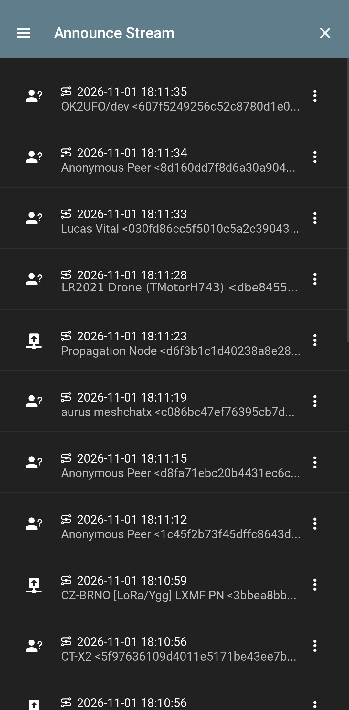
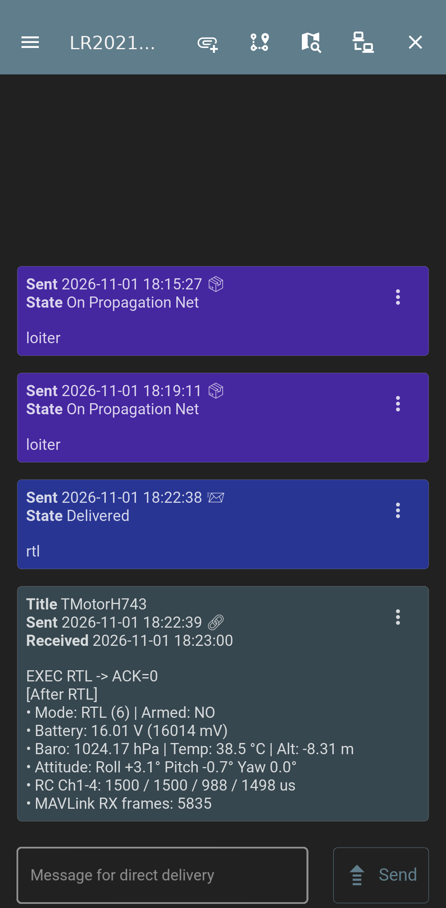
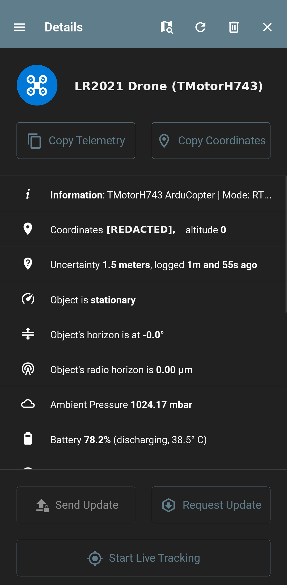

# Hardware & SITL Verification Results

This document records the hardware and simulation tests run against the `lr2021-elrs` firmware.

### Test Hardware & Software Environment
- **Radio Boards**: Two `LR2021EVK1XBS1_XIAO` boards (`Seeed Studio XIAO nRF54L15` + `Wio-LR2021` Rev B `0x0118`, CMSIS-DAP serials `FC6D1A37` on `/dev/ttyACM5` and `D56B6941` on `/dev/ttyACM7`).
- **Flight Controller**: ArduPilot `TMotorH743` (`/dev/ttyACM4`) and multi-instance ArduCopter SITL (`anisoptera`).
- **Handset & Receiver**: RadioMaster TX16S MK3 + RadioMaster XR4 (`2× LR1121`).
- **Reticulum & LXMF**: `RNS 1.5.7` (`RNodeInterface`) and Sideband v1.9.8 (`io.unsigned.sideband`).

---

## 1. Host Unit Tests (`tests/test_elrs_host.cpp`)

All 15 host unit test suites run cleanly under `g++`:
1. `test_uid_md5`: ExpressLRS MD5 binding phrase to 6-byte UID derivation.
2. `test_fhss_invariants`: FHSS hop sequence generation across `AU915`, `FCC915`, `EU868`, and `ISM2G4`.
3. `test_ota4_and_ota8_roundtrip`: `SYNC`, `RC4`, `RC8`, and `LINKSTATS` packing, unpacking, and `CRC14`/`CRC16`.
4. `test_crsf_framing`: CRSF `RC_CHANNELS_PACKED` (`0x16`), `LINK_STATISTICS` (`0x14`), and stream parser.
5. `test_demo_live_packets`: Packet validation with binding phrase `"lr2021-elrs-demo"`.
6. `test_rnode_kiss_framing`: KISS `FEND`/`FESC` escaping, `CMD_DATA`, and `CMD_STAT_PHYPRM`.
7. `test_rns_relay_dedup_and_ifac`: 64-entry FNV-1a invariant hash ring, hop increment, and IFAC byte preservation.
8. `test_fc_mavlink_and_beacons`: `rnlog.beacon`, `elrs.drone.cmd`, and MAVLink v2 `#70`/`#73`/`#76` generation.
9. `test_elrs_data_tunnel`: `OTA8` (`13B`) and `OTA4` (`8B`) fragmentation and reassembly with simulated packet loss.
10. `test_rns_identity_pairing_and_lua_crsf`: SHA-256, 16-byte `SINGLE` `dest_hash`, `RNSA`/`RNSP`/`RNSC`, and CRSF `0x7A`/`0x7B`/`0x21`.
11. `test_edgetx_lua_script_end_to_end`: Embedded Lua 5.2 VM executing [`tools/rns_elrs.lua`](../tools/rns_elrs.lua) Pages 1–4 against C++ CRSF decoders.
12. `test_multi_drone_mesh_and_formation`: 64-byte `RNSF` formation packets, multi-hop ping-pong relay chain with hop and TTL expiration, and MAVLink `#84`/`#86` velocity/position-velocity frames.
13. `test_slot_tdma_and_multi_drone_bundle`: Deterministic `(slot_id - 1) × 45 ms` Slot-TDMA relay windows and 64-byte `RNSM` (`0xA8`) 4-drone command bundle roundtrip + tamper rejection.
14. `test_xr4_lr1121_dual_radio_and_bridge`: RadioMaster XR4 (`2× Semtech LR1121`) SPI driver initialization (`0x0112` RF switch `{15,0,12,8,8,6,0,5}`, `HF_PA`/`HP_PA`, 8B↔14B Hamming FEC with 1-bit error correction) and simultaneous `2G4_K1000` ELRS + `868 MHz` `RNSM` LoRa mesh bridging + `45 ms` Slot-TDMA relay without interrupting 2.4 GHz FHSS hops.
15. `test_t_display_p4_trx_unit`: LilyGo T-Display P4 (`ESP32-P4NRW32` + `RM69A10` `1232×568` AMOLED / `HI8561` `1168×540` TFT + `Semtech LR2021`) dual-gimbal touch mapping, `TCXO 3.0 V` + `AT2401C` FEM + `SKY13453` RF switch init sequence, `L76K` NMEA `$GNGGA` parser, GPS Follow-Me formation leader broadcasts, and Landscape RGB565 HUD rendering.

---

## 2. 867.2 MHz `RNODE` KISS TNC ↔ Airborne `RELAY` ↔ `TMotorH743` Flight Controller

- Verified RNode KISS handshake (`CMD_DETECT=0x46`, `CMD_STAT_PHYPRM=040003d00012001300020006`, `CMD_READY=0x01`).
- Verified `TMotorH743` MAVLink v2 ingestion: `HEARTBEAT` (`#0`), `SYS_STATUS` (`#1`, `16,019 mV` 4S LiPo), and `GLOBAL_POSITION_INT` (`#33`).
- Verified over-the-air `rnlog.beacon` JSON reception (`rssi=-95 dBm`, `snr=+14.25 dB`), unmasked store-and-forward (`hops: 0 -> 1`), duplicate suppression (`relay_drop=1`), and IFAC preservation (`ifac=1`).
- Executed `LOITER`, `RTL`, `LAND`, `MODE 2`, `GOTO -353632620 1491652370 85`, `ARM`, `DISARM`, and `MODE 0` on the `TMotorH743`, confirming `COMMAND_ACK result=0`, `MISSION_ACK`, and `HEARTBEAT.custom_mode` transitions `0 -> 5 -> 6 -> 9 -> 2 -> 0`:

```text
[RELAY] RNS_CMD_RX src=LORA hops=0 cmd="LOITER" type=2 mav_len=45 mav_hex=FD21000000FFBE4C00000000000000000000000000000000000000000000000000000000000011000101008AB3
[TMotorH743 COMMAND_ACK] COMMAND_ACK {command : 17, result : 0, progress : 0, result_param2 : 0, target_system : 255, target_component : 190}
[TMotorH743 HEARTBEAT] HEARTBEAT {type : 2, autopilot : 3, base_mode : 89, custom_mode : 5, system_status : 3, mavlink_version : 3}
[RELAY BCN] OK RNS_BCN_TX sent=1 len=136 json={"src":"lr2021-drone","lat":0.00000,"lon":0.00000,"alt_m":-1,"vbatt_mv":16011,"mode":5,"armed":0,"lq":100,"rssi":-95}
```

---

## 3. Bidirectional Reticulum-over-ExpressLRS FHSS Tunnel (`ELRS_PKT_TYPE_DATA`)

- Verified fragmentation and reassembly of uplink `elrs.drone.cmd` (`MODE 5`, `RTL`, `LAND`, `GOTO`, `RC 1620 1380 1050 1510`, `RC 0 0 0 0`, `MODE 0`) and 135-byte downlink `rnlog.beacon` packets across `OTA4` (`8 B`) frames on `EU868 900_200HZ` and `CE_LBT 2G4_K1000` (`2,882 / 2,883 = 99.97%` uplink CRC, `988 / 988 = 100%` downlink telemetry CRC):

```text
ELRS_RNS_RX len=135 hops=0 hex=080018BCD8A3DEA16EF6765C6B27D008D220007B22737263223A226C72323032...
RNS_BCN_RX src=ELRS_TUNNEL hops=0 len=135 json={"src":"lr2021-drone","lat":0.00000,"lon":0.00000,"alt_m":0,"vbatt_mv":16018,"mode":6,"armed":0,"lq":100,"rssi":-95}
RNS_CMD_RX src=ELRS_TUNNEL hops=0 cmd="RC 1620 1380 1050 1510" type=5 mav_len=30 mav_hex=FD12000003FFBE460000540664051A04E60500000000000000000101BA5A
[TMotorH743 RC_CHANNELS] ch1=1620 ch2=1380 ch3=1050 ch4=1510 rssi=255
```

---

## 4. Official Reticulum (`RNS 1.5.7`) & Sideband v1.9.8 ↔ 867.2 MHz LoRa ↔ `TMotorH743`

- Verified `RNODE_HW_MTU = 508` multi-frame LoRa fragmentation (`0xFE 0xCA` framing over `<= 250 B` LoRa packets).
- Established `RNS.Link` (`500 B` MTU, `RTT = 560 ms`, `RSSI = -96 dBm`, `SNR = +14.25 dB`), executed LXMF commands (`rtl`, `mode 0`) with `ACK = 0`, and verified telemetry rendering in Sideband (`1024.17 mbar`, `38.5 °C`, `78.2%` / `16.01 V`, `Mode: RTL (6)`):

| Announce Discovery (`867.2 MHz`) | Contact & Quadcopter Icon | Bidirectional `rtl` -> `TMotorH743` | Live `TMotorH743` Telemetry |
| :---: | :---: | :---: | :---: |
|  |  |  |  |

---

## 5. OTA Pairing (`RNSP`), Node Announce (`RNSA`), Targeted Commands (`RNSC`) & Lua CRSF (`0x7A`/`0x7B`)

- Board 1 (`hw_id=292fecd1c3f50a7c -> dest=b535904babf85e6d9ef1ab15ec1061f9`) paired over the air with Board 2 (`hw_id=f8be88db9cf69ef8 -> dest=4cef6984feb38c2429a1efa42b89c149`) on `EU868 900_200HZ`.
- Verified targeted `rns_to sel PING` (`rtt_ms=577`) and `crsf_lua loiter` (`RNS_CMD_ACK_RX ack="ACK:LOITER" rtt_ms=636`).

```text
[RX] RNS_PAIRED src=ELRS_TUNNEL tx_dest=b535904babf85e6d9ef1ab15ec1061f9 rx_dest=4cef6984feb38c2429a1efa42b89c149 freq=869525000 bw=250000 sf=8 cr=4/6 pwr=14dBm ifac=1 reply_ann=1
[TX] RNS_PEER_ANNOUNCE src=ELRS_TUNNEL idx=0 dest=4cef6984feb38c2429a1efa42b89c149 role=2 hops=0 name="LR2021-RX" vbatt=25200mV mode=0
[TX] RNS_CMD_ACK_RX src=ELRS_TUNNEL from=4cef6984feb38c2429a1efa42b89c149 hops=0 seq=2 rtt_ms=636 ack="ACK:LOITER"
```

---

## 6. Multi-Drone 868 MHz Formation Flight (`RNSF` / `#86`), Ping-Pong Relay Chain & 3.0 s Watchdog

Verified using [`tools/rns_multi_drone_sitl.py`](../tools/rns_multi_drone_sitl.py) with two ArduCopter SITL instances (`-I0` Leader, `-I1` Wingman 1) bridged across the two physical LR2021 boards (`FC6D1A37` and `D56B6941`) on `868.0 MHz` (`BW = 500 kHz, SF = 7, CR = 4/5`):

1. **Vee Formation Convergence (`10.0 m` spacing, Leader flying `5.0 m/s` North)**:
   - 8/8 `RNSF` packets received over 868 MHz RF by `D56B6941` and 8/8 relayed (`hops = 0 -> 1`).
   - Wingman 1 converged from `(-15.2 m N, -15.0 m E)` onto its Slot 1 Vee offset `(-10.0 m N, -10.0 m E)` at `Vn = 4.9–5.0 m/s`:
   ```text
   [Step 1/8] 868MHz RNSF->Wing1 OK (mav_len=65B, relay_fwd=1) | Slot1 Target Offset=(-10.0m N, -10.0m E) | Wing1 Actual Offset=(-15.2m N, -15.0m E) Vn=0.0m/s
   [Step 4/8] 868MHz RNSF->Wing1 OK (mav_len=65B, relay_fwd=4) | Slot1 Target Offset=(-10.0m N, -10.0m E) | Wing1 Actual Offset=(-9.8m N, -9.9m E) Vn=6.1m/s
   [Step 6/8] 868MHz RNSF->Wing1 OK (mav_len=65B, relay_fwd=6) | Slot1 Target Offset=(-10.0m N, -10.0m E) | Wing1 Actual Offset=(-10.0m N, -10.0m E) Vn=4.9m/s
   [Step 8/8] 868MHz RNSF->Wing1 OK (mav_len=65B, relay_fwd=8) | Slot1 Target Offset=(-10.0m N, -10.0m E) | Wing1 Actual Offset=(-10.1m N, -10.0m E) Vn=4.9m/s
   ```
2. **3.0 s Dead-Man Failsafe Watchdog**:
   - After `3.0 s` without RF formation updates, `D56B6941` emitted `RNS_MESH_FAILSAFE action=LOITER timeout_ms=3000` and Wingman 1 braked to `Vn = -0.02 m/s, Ve = 0.00 m/s`.
3. **4-Hop Ping-Pong Relay Chain & Hop/TTL Expiration (`rns_chain 4 120 3000` & `rns_chain 10 250 550`)**:
   - Single `RNSF` packet bounced 4 hops across `FC6D1A37` and `D56B6941` (`hops = 0 -> 1 -> 2 -> 3 -> 4`, computing Slots `1..5`) and stopped at `hops == 4` (`RNS_RELAY_EXPIRED hops=4 max_hops=4 ttl_ms=3000 total_exp=1`).
   - With `ttl_ms = 550` and `delay_ms = 250`, the chain stopped at `hops = 2` (`562 ms > 550 ms`) with `RNS_RELAY_EXPIRED hops=2 max_hops=10 ttl_ms=550 total_exp=1`.
3. **Combined 64B Multi-Drone Bundle (`RNSM` `0xA8`), Deterministic Slot-TDMA & Hybrid `ELRS_RX` LoRa Burst**:
   - **Single-Packet 4-Slot Execution**: Transmitting `rns_multi OFS:-10,-15,5 VEL:5,-2,0 LOITER RTL` across `rns_chain 4 120 3000` executed all four slot actions across four RF hops from a single 64-byte frame:
     - `hops=0` (`Slot 1`): `RNS_MULTI_RX src=LORA hops=0 seq=1 slot=1 act=1 type=10 lat=-353633518 lon=1491650718 alt_m=30 mav_len=65` (`MAVLink #86 GLOBAL_POS_VEL`)
     - `hops=1` (`Slot 2`): `RNS_MULTI_RX src=LORA hops=1 seq=1 slot=2 act=2 type=9 vx=500 vy=-200 mav_len=65` (`MAVLink #84 VEL_NED`)
     - `hops=2` (`Slot 3`): `RNS_MULTI_RX src=LORA hops=2 seq=1 slot=3 act=3 type=2 mav_len=45` (`MAVLink #76 LOITER`)
     - `hops=3` (`Slot 4`): `RNS_MULTI_RX src=LORA hops=3 seq=1 slot=4 act=4 type=1 mav_len=45` (`MAVLink #76 RTL`) -> `RNS_RELAY_EXPIRED hops=4 max_hops=4`
   - **Hybrid 200 Hz `ELRS_RX` -> 868 MHz LoRa Mesh Burst**: While locked on `EU868 900_200HZ` (`ELRS_TX` -> `ELRS_RX`), tunneling `rns_multi` over odd FHSS nonces triggered `ELRS_RNS_RX len=64` -> `RNS_HYBRID_BURST_TX len=64 hops=1 freq=868000000 burst_cnt=1` on the single-radio receiver while `TIMER20` maintained `OtaNonce` + `FHSS` lock (`STATUS mode=ELRS_RX lock=CONNECTED crc_ok=358 crc_err=3 phase_err=-12us`).
   - **Autonomous Leader Formation Broadcast (`rns_form auto vee 12.0 450 4.0 0.0`)**: Board 1 in `ELRS_RX` mode automatically broadcast 64B `RNSF` LoRa bursts every `450 ms`, which Board 2 (`RELAY`, `Slot 1`) decoded over 868 MHz RF (`RNS_FORM_RX src=LORA hops=0 seq=1..3 shape=2 slot=1 lat=-353633697 lon=1491651049 vx=400 mav_len=65`) and forwarded (`RNS_RELAY_FWD len=64 hops=1`).
   - **Cross-Band Live Bench Loop (`TX16S MK3 + XR4 + TMotorH743` on `2G4_K1000 CE_LBT` -> `868.0 MHz` `RNSM` LoRa Burst -> Wingman `D56B6941`)**: With `FC6D1A37` locked to the live `TX16S MK3 ↔ XR4` 1000 Hz 2.4 GHz link (`UID=EB:71:09:FA:46:6A`, `vbatt=16024 mV`, `chancount=16`), firing `rns_multi OFS:-10,-15,5 VEL:5,-2,0 LOITER RTL` switched `FC6D1A37` from `2.4 GHz GFSK` to `868.0 MHz LoRa` (`RNS_HYBRID_BURST_TX len=64`), delivered `MAVLink #86` (`mav_len=65`, `rssi=-90 dBm`, `snr=+15 dB`) to `D56B6941`, and snapped back to `2G4_K1000` while maintaining lock (`crc_ok: 1438 -> 2175`, `hops: 1088 -> 1913`, `phase_err: 6 us -> 3 us`).

---

## 7. LilyGo T-Display P4 (`ESP32-P4NRW32` + `RM69A10` AMOLED + `Semtech LR2021`) Dual-Band OTA Verification

Verified on a USB-attached **LilyGo T-Display P4** (`/dev/ttyACM7`, MAC `30:ed:a0:e1:c3:58`) transmitting simultaneously to both `XIAO nRF54L15 + Wio-LR2021` receivers (`RX5` on `/dev/ttyACM5` and `RX6` on `/dev/ttyACM6`):

1. **Onboard Peripheral Bring-Up**:
   - `32 MB` Hex PSRAM at `200 MHz` (`MSPI DQS: tuning success`, `SPI SRAM memory test OK`).
   - Auto-detected `GT9895` multi-touch (`0x5D` on `I2C1`) and `RM69A10` `568×1232` AMOLED panel (`1232×568` Landscape RGB565 HUD rendered over MIPI-DSI).
   - `Semtech LR2021` on `SPI2` (`GET_VERSION = 0x0118`, `TCXO = 3.0 V` on `DIO3`, `AT2401C` 2.4 GHz FEM on `DIO7/DIO8`, `SKY13453` Sub-GHz RF switch on `DIO9`).
   - `BQ27220` fuel gauge (`4106–4110 mV`, `95%` SoC), `ICM20948` 9-axis IMU (`0x68` on `I2C2`), `AW86224` haptic driver (`0x58`), and `XL9535` I/O expander (`0x20`).
2. **2.4 GHz Band (`2G4_250HZ`, `rate=18`, `ISM2G4`, `+5 dBm` via `AT2401C` FEM)**:
   - `RX5` (`/dev/ttyACM5`): `lock=CONNECTED`, `crc_ok=1021/1054` (`96.9%`), `rssi=-66 dBm`, `snr=13.75 dB`, `phase_err=-28 us`.
   - `RX6` (`/dev/ttyACM6`): `lock=CONNECTED`, `crc_ok=1034/1104` (`93.7%`), `rssi=-80 dBm`, `snr=12.50 dB`, `phase_err=-17 us`.
   - Live virtual gimbal + arm deflection (`arm 1` + `stick lx=-0.5 ly=0.75 rx=0.6 ry=-0.25` -> `CH1=1421 CH2=825 CH3=1606 CH4=644 CH5=1792`) tracked on both `RX5` and `RX6` as `RC_US ch1=1769 ch2=1397 ch3=1884 ch4=1284 ch5=2000 armed=1`.
   - Tunneled 64B `RNSF #1` (`rns_form 0`) and 64B `RNSM #1` (`rns_multi`) reassembled on both receivers (`RNS_FORM_RX src=ELRS_TUNNEL seq=1`, `RNS_MULTI_RX src=ELRS_TUNNEL seq=1 slot=1 act=1 type=10 lat=515072602 lon=-1279023 alt_m=50 mav_len=65`) and bridged into 868 MHz LoRa mesh bursts (`RNS_HYBRID_BURST_TX`).
3. **Sub-GHz 868 MHz Band (`900_200HZ`, `rate=3`, `EU868`, `+14 dBm` LF PA)**:
   - `RX5` (`/dev/ttyACM5`): `lock=CONNECTED`, `crc_ok=953/965` (`98.8%`), `rssi=-70 dBm`, `snr=13.25 dB`, `phase_err=-26 us`.
   - `RX6` (`/dev/ttyACM6`): `lock=CONNECTED`, `crc_ok=662/673` (`98.4%`), `rssi=-79 dBm`, `snr=12.75 dB`, `phase_err=-48 us`.
   - Both `RX5` and `RX6` tracked `RC_US ch1=1769 ch2=1397 ch3=1884 ch4=1284 ch5=2000 armed=1` and received tunneled `RNSF #2` and `RNSM #2`.
